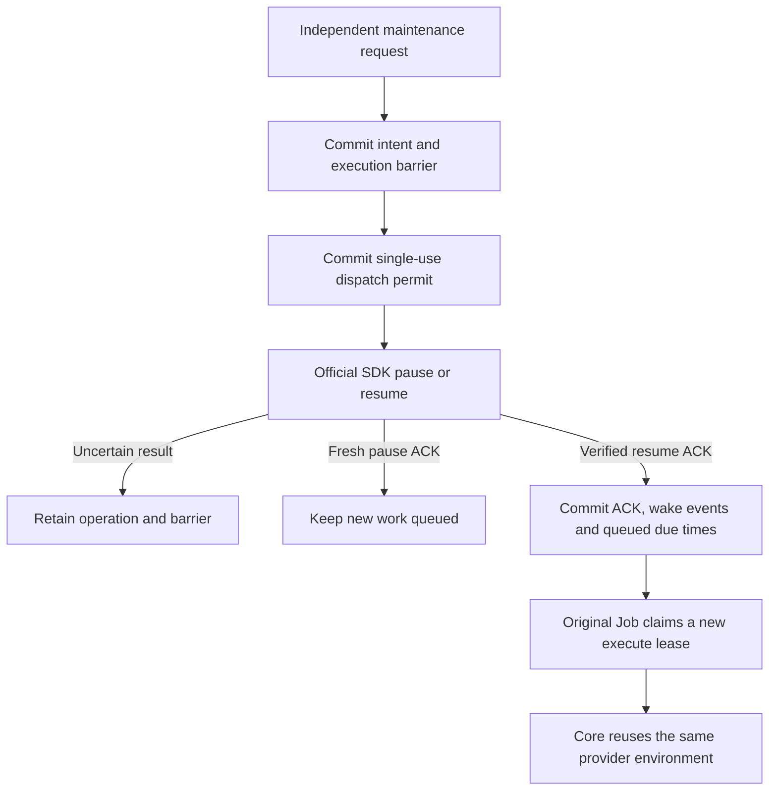

# E2B execution integration

The hosted product reuses the official E2B SDK for environment lifecycle.
Centaeris owns task admission, queueing, authorization, cancellation intent,
cleanup obligations and delivery. Core remains the authority for the native
Agent's tools, events, checkpoints and continuation. E2B owns its sandboxes,
physical admission and snapshot implementation.

This work is limited to hosted lifecycle with the existing Core harness.
External harness validation follows hosted acceptance. Subscription interfaces,
account sharing, billing redesign, Desktop isolation and a workflow engine
are separate work.

## Evidence status

Creation, perRun and retained execution, scoped Run cleanup, independent retirement,
and explicitly requested pause/resume are implemented through the existing Core
harness and the pinned official SDK. Automatic idle selection and demand-triggered
resume are frozen outside this change; no background idle policy is enabled.
The default remains `perRun`, with global / Workspace / ordinary Worker execution
capacity 8 / 4 / 8.

| Evidence | Current boundary |
| --- | --- |
| Earlier real-provider product builds | perRun A/B, retained A/B with Runtime restart, explicit pause/resume with queued work, and independent retirement passed on the identified builds below |
| Current recovery and diagnostic changes | Focused automated contracts cover late-target creator cleanup, missing-context and Unknown preservation, and distinct lifecycle failure stages; final candidate gate results must be recorded separately from the historical build counts |
| Interrupted instrumented real-provider sample | Stopped in Run A before pause/resume with an unresolved dispatched create and no locator or settlement. After reboot the tmpfs PostgreSQL ledger is absent; its original owner record and Unknown responsibility remain preserved |
| Release and legacy-removal acceptance | Current full lifecycle stage timings, combined saturation, the wider restart/failure matrix, and the legacy drain/removal gate remain incomplete |

The executable hashes, image digests, test counts and measurements below identify
historical builds. They do not establish that later source changes passed real
provider acceptance or the complete release gate. The original Unknown must not be settled or its owner replaced. A separately
owned isolated current-build scheduling sample is explicitly authorized; it must
keep a distinct ledger and may not imply resolution of the original create.

## Current execution flow

The existing AgentRun, lifecycle Job and Core loop use a
`HostedExecutionContext` with execution, workspace and artifact ports.
The E2B factory creates the SDK context under the current signed controller
and Job lease. Bounded Run and Environment registries preserve the context,
command streams and helper-effect evidence across same-process Job yields.
Each retained successor receives a separate Run authority and command history;
only physical activity, helper uncertainty and the verified capture baseline
are shared. Reclaiming a Job
rechecks its authority before reusing the context. A physical container or a
cached context alone does not prove workspace preparation succeeded.

~~~mermaid
flowchart TD
    A["API: authorize Workspace and freeze policy"] --> B["Existing queue and lifecycle Job"]
    B --> C["Worker: one execute or control lease"]
    C --> D["Runtime: verify authority and persist provider attempt"]
    D --> E["E2B factory, Environment binding and Run registry"]
    E --> F["Pinned official SDK and E2B sandbox"]
    F --> G["Existing Core: files, Bash and artifacts"]
    G --> H["Protect final SessionWorkspace"]
    H --> T["Authoritative Run terminal"]
    T --> I["Scoped Run cleanup and durable receipt"]
    I --> J["Controller release and server-checked Job completion"]
    I -->|"retained"| P["Environment binding and VM remain"]
    P -->|"independent maintenance"| R["Durable retirement intent, exact removal and settlement"]
    K["Cancellation intent"] --> C
    E --> L["Unknown: preserve identity and investigation duty"]
    L --> D
~~~

The default policy remains `perRun`, workspace `/mnt/data`, user `agent`.
Each perRun Run uses a separate sandbox; a later Run in the same Session restores the
committed workspace through the existing SessionWorkspace API and snapshot
codec. This is file continuity, not memory or process restoration.
An explicitly frozen `retained` profile supports successive Runs in the same
running sandbox and independent Environment retirement, as described below.

Core file operations, Bash and artifact publication use the E2B ports. HTTP MCP
can use its existing connection path. Declared attachments, plugin skill/CLI
file projections, lifecycle hooks and MCP stdio are rejected before provider
creation. Environment background tasks and private memory volumes remain
unsupported. The helper-only template does
not imply that host files or plugin packages have been projected into it.

The fixed template must include the execution helper, workload UID/GID 10001,
`/bin/bash`, `/usr/bin/setpriv`, `/usr/bin/head` and `/usr/bin/wc`. Filesystem
helpers execute as that workload identity. Root opens the private request before
executing the helper under the workload identity; the bounded response sink
remains root-owned. Workload files retain the same ownership as ordinary Bash
writes.

The legacy backend remains present for existing obligations. E2B startup no
longer requires Docker image inspection, the legacy host socket or its supervisor.
This routing change does not establish that the full legacy implementation can
already be removed.

## Startup and signed policy

Runtime selects E2B by default and fails startup without an explicit deployment
configuration. `RUNTIME_EXECUTION_PROVIDER=docker` selects the legacy backend.
The E2B deployment supplies these settings:

| Setting | Contract |
| --- | --- |
| `RUNTIME_E2B_PROFILE_PATH` | Absolute path to the strict, bounded profile configuration loaded once at startup |
| `RUNTIME_E2B_PROVIDER_CONFIG_DIGEST` | Public configuration/account-scope identity matching the selected profile |
| `RUNTIME_E2B_PYTHON` | Absolute trusted Python interpreter path |
| `RUNTIME_E2B_ADAPTER_PACKAGE_ROOT` | Absolute trusted adapter package root |
| `RUNTIME_E2B_REQUEST_TIMEOUT_SECONDS` | Positive transport deadline, at most 60 seconds; defaults to 20 |

The [host adapter](../../packages/e2b_adapter/README.md) pins Python SDK 2.58.0.
Runtime launches it directly with an isolated interpreter and fixed bootstrap,
without a shell or ambient Python search path. Credentials remain deployment
inputs; they are not profile fields or part of the public configuration digest.
The SDK receives explicit control-plane and sandbox-data endpoints.

The E2B advertisement uses `runtime.execution_profile.v2` with the selected
environment profile. API and Runtime validate the distinct signed
`runtime.e2b_environment_profile.v1` schema and
[shared profile fixture](../../tests/workspace/fixtures/e2b_environment_profile/v1/valid.json).
It freezes provider configuration, template/build identity, workspace, user,
network, lifetime, timeout and input-transfer budget. The template build is a
canonical UUID, passed to the SDK as `templateId:buildId`; mutable tags do not
substitute for it. Later advertisements or Worker configuration cannot replace
an Environment's bound policy. Legacy payloads, digests and signatures retain
their exact meaning.

`inputBudgetBytes` limits Centaeris input and restore traffic. It is not a
filesystem quota. The profile makes no byte, inode, PID or tmpfs hard-limit
claim. Unknown fields, duplicate fields and unsupported schemas fail explicitly.

## Provider effects and control

Before a provider effect, the business store commits the exact Environment,
Run, execution, profile, configuration and lifecycle Job identities, stable
attempt/key and responsible owner. A durable dispatch CAS grants one send or
closes a proven unsent operation. A known sandbox ID is immutable within that
attempt. Provider observations supplement this ledger rather than becoming a
second node-placement or VM state machine.

SDK action and connection retries are disabled. A timeout, empty lookup,
expired lease or expired provider idempotency window never authorizes a new
create or refund. A reconstructed Runtime can read-only attach a retained
successor after the prior Run has valid cleanup and release facts. It does not
resume or extend the sandbox timeout. An open consumer whose command streams
were lost remains pending. Verified first creation without its original live
context also remains pending; it cannot prove initial workspace preparation.
Provider idempotency is
an optional additional capability and remains unverified in the local
deployment. A client capability flag does not enable it on the server.

Keep global 8 / Workspace 4 / ordinary Worker 8 as the acceptance baseline.
These are business execution limits; physical admission belongs to E2B.
A control lease does not authorize ordinary execution, create or resume.
Ordinary, short control and slow cleanup use independent adapter process
instances because the SDK shares its sandbox connection pool within a process.
Transport deadlines cover blocked stdin and response reads. Losing a response
closes that transport without replaying the request; it does not prove the
provider action stopped.

PerRun cleanup requires current signed cleanup authority. It verifies the complete
provider binding, persists the exact target and removes that sandbox through
the cleanup lane. A durable verified target avoids repeated observation before
deletion. Only proven non-dispatch or exact verified removal settles an
operation. Unresolved effects retain both budget and cleanup responsibility.
Ordinary PID signaling is not process-tree cleanup evidence.

There are three explicit receipt contracts:

- The physical provider cleanup receipt keeps a positive `operationCount` and
  requires every covered operation to be settled.
- `runtime.agent_run.cleanup_receipt.no_provider_effects.v1` proves that a
  terminal Run has no provider creation operation or unresolved responsibility
  requiring cleanup. It carries no invented sandbox, deletion or settlement
  fact. An arbitrary legacy `neverAllocated` receipt cannot substitute for it.
- `runtime.agent_run.cleanup_receipt.retained_provider.v1` binds one immutable
  `providerUseId` and digest with scope `runEffectsOnly`. Current cleanup pins
  require the original Run's commands to be closed, helper effects known,
  fixed quiescence successful and the subsequent workload process count zero.
  This proof retains the Environment and its provider creation responsibility.

All paths still require the real API controller release and server-checked
Job completion. Terminal state, provider settlement, cleanup receipt, controller
release and complete remain separate durable facts. Unknown cannot disappear
behind a successful legacy receipt or a zero-operation shortcut. A successor
Run's later legitimate allocation does not invalidate an earlier immutable
no-effects proof.

## Workspace protection and retention

The workspace port reuses the existing authorized resolve, restore, immutable
snapshot commit and uncertain-commit reconciliation protocol. Snapshot and
artifact helpers use the execution activity witness and exclusive capture
guard. Unknown mutating helper effects prevent a later runner from declaring
the workspace safe; quiescence does not erase that uncertainty.

The bridge bounds inline files to 256 KiB and command output to 64 KiB. Larger
binary files use the bounded spool protocol with a 128 MiB per-transfer ceiling,
stable file identity, byte counts and SHA-256 verification. The Core filesystem
port retains its 64 MiB binary contract. Original command streams preserve
stdout/stderr bytes, including invalid UTF-8. These transport limits are
independent of the signed input-transfer budget.

Helper stdout has its own bounded sink and exact-length check. Its reply budget
must not impose a process-wide file-size limit on restored or written workspace
files. Oversized output and nonzero helper exit remain uncertain effects; they
never authorize a successful restore, cache seed or staging cleanup.

E2B environment retention or pause and Centaeris product archives serve
different purposes. Running retained reuse keeps the existing final archive
protection policy. Idle pause and a later policy that coalesces archives only
at required protection or delivery boundaries need separate measurement and
acceptance. Conditional terminal
capture now borrows one verified descriptor/manifest from the surviving E2B
runner. A successful verified restore seeds it; rejected or unknown work cannot
retain it. A matching receipt skips the full snapshot download and canonical
spool while preserving transfer admission and current dispatch authority.
Source content is still read twice, and changed content still transfers a full
frame. The API already skipped uploads for equal descriptors.

The supported retained boundary quiesces Run work while preserving the running
VM and its files. It does not add Environment task scopes. Files, native harness sessions, memory
snapshots and online services are distinct promises. An accepted pause does
not prove full-memory preservation. Existing retained environments keep their
original obligations; the initial E2B route does not reinterpret them.

## Behavioral acceptance

| Boundary | Required evidence |
| --- | --- |
| SDK requests | Pinned SDK with isolated HTTP fixtures: exact template/build/key, zero retries after lost response or error, known identity retained and secrets redacted |
| Transport | Process reuse, bounded correlated frames, blocked-input deadline and control progress while ordinary remains blocked |
| Authorization | Strict shared Python/Rust fixtures, immutable policy, unsupported capability rejection before create and unchanged legacy signatures |
| Persistence | Real PostgreSQL first-use freeze, later defaults ignored, mismatch rollback, old grants preserved and durable unknown duties |
| Core execution | Actual API, Worker, Runtime, Core and SDK perform file/Bash operations and publish the artifact's real bytes |
| Session continuity | perRun restores committed files in a distinct sandbox; explicit retained reuses the exact sandbox with a distinct authorized Run use and no archive restore |
| Recovery | Lost create/command replies and adapter/Runtime restart preserve provider identity and duties without replaying accepted effects |
| Cancellation | Ordinary execution, Worker, HTTP, DB and SDK saturation do not prevent scoped cleanup, release and complete |
| No effects | A pre-create rejection completes through an explicit no-provider-effects receipt, actual controller release and completion checks |
| Retirement | Exact provider identity is absent and covered obligations are settled; deletion cannot hide an unknown create |
| Legacy removal | A hosted stack without the old socket, runsc or supervisor completes the same supported Core workflow after old duties drain |

Unit, PostgreSQL, real-provider and performance results remain separate.
The opt-in product test uses the actual lifecycle and Core tools with a
deterministic loopback model rather than an external model request. It uses
explicitly owned PostgreSQL state and preserves that state if provider duties
remain unsettled. Fixture success is not Firecracker or full product acceptance.

Earlier local Embed builds passed the core perRun functional baseline through
the actual API, Worker, Runtime, Core and pinned SDK. Run A commits its workspace
and deletes its sandbox; Run B in the same Session uses a distinct sandbox,
restores A's files, modifies them and publishes its own artifact. The test
verifies downloaded artifact bytes and hashes, provider removal settlements,
positive cleanup receipts, API controller releases, successful Jobs and exact-ID
provider NotFound responses. Both sequential sandboxes are removed and no
provider obligation remains pending. Filesystem helpers run under the workload
UID/GID, preserving snapshot ownership safety.

A separate real-provider case verifies cancellation of the original Run after
Runtime stops: API cancellation advances through Worker control, exact cleanup,
release and complete, followed by exact-ID provider NotFound. Combined
saturation, the wider failure/restart matrix and the final release gate remain
incomplete. Explicit pause/resume has separate historical evidence below;
automatic idle policy remains deferred. This functional baseline establishes neither a
latency SLO nor incremental snapshot performance, and does not authorize legacy
removal.

### Running retained acceptance

Migration 19 adds an immutable Environment-to-creation binding, separate Run
uses and retirement intents. Original creation identity remains provenance;
each successor uses its own signed controller epoch, lease and logical
execution ID. Old signed data is preserved without inferring historical
retention. Preparation and cleanup take the local Environment guard before the
Run guard and current store pins. Only a positive factory reuse result skips
archive restoration. Retirement requires a separate maintenance token, the
released Environment epoch, valid cleanup and release facts for every use,
and exact verified provider removal. The durable retirement intent precedes
deletion; API profile resolution and execute-controller admission check it
under the same Environment row lock. The admission race has source and
component evidence; a two-connection API-versus-retirement race is not yet run.

The real Core A/B fixture passed on an earlier retained-lifecycle build after an
initial functional pass. This identified historical sample used SDK
2.58.0, Runtime executable SHA-256
`2eaa44ba2843136311a422c62cebd609e944743aa7c413a02c1ce3b06e699006`
and template digest
`dc05f652df4d1d28eb6af6234478021b9f92fafa0eb2373be737ffc386d159e9`.

| Measured boundary | One sample |
| --- | ---: |
| Run A lifecycle | 4,417.037 ms |
| Runtime restart | 390.050 ms |
| Run B lifecycle | 4,248.182 ms |
| Independent Environment retirement | 390.252 ms |
| Test case / invocation including database setup | 10.900 s / 21.203 s |

A and B used distinct use records and logical execution IDs, with the same
VM, instance and immutable creation metadata. A `/tmp` marker verified guest
file continuity outside the workspace archive. Both Runtime stdout streams
drained completely; bounded observations included successful full captures for
both Runs without dropped records, and no B Session restore, download or apply
record. Each Run reached a valid scoped cleanup receipt, API release and Job
completion. Ordinary authority was denied retirement; separate maintenance
authority removed the exact sandbox, and historical receipts remained readable.
Pending creation and use counts reached zero before the owned database was
removed. This unoptimized functional sample is not comparable with the release
benchmark below and establishes no latency distribution or SLO.

For that retained-lifecycle build, the provider PostgreSQL suite passed 72 tests
before the final prior-receipt check. Its final candidate passed all 26 retained
PostgreSQL tests, including
two new negative tests for unbound prior receipt/use/quiescence facts. API (40),
SDK (101), Core `query_loop` (129), ordinary Runtime (624 passed, 286 ignored),
and Runtime Clippy across all targets passed. All 194 required PostgreSQL test
identities exist in the 910-test executable. Ignored tests and the remaining
public release gates are not covered by ordinary Runtime test success.
Attach or context construction failure after a Run use is bound remains a fail-closed recovery
obligation; automatic recovery of that missing context is not accepted. Automatic product
idle policy is deferred. Workload-scale memory reclamation, combined saturation,
Harbor/TB2.1 and legacy removal remain separate acceptance boundaries. The diagnostic below
measures one provider pause and does not satisfy those product gates.
The perRun default is unchanged.

### Durable provider pause and resume

`POST /internal/environments/power` requires the distinct maintenance token
and an explicit retained profile. The strict `runtime.provider_environment.power.v1`
request binds `operationId`, `action`, `environmentId`, `creationAttemptId`,
`sandboxId`, `providerConfigDigest`, `expectedControllerEpoch`, and an explicitly
nullable `predecessorOperationId`. A cycle starts with pause and then alternates
using the latest acknowledged operation as its predecessor. A historical ACK is
an immutable operation result, never a claim about the provider's current state.

Migration 20 adds a durable operation journal and the derived
`runtime.provider_environment_power_admission` view. The intent commits before
an independent dispatch CAS can produce a one-use permit. The physical callback
holds the released Environment epoch and validates the original creator and all
consumer cleanup/release facts. A fresh dispatch discards the old live SDK handle;
ACK replay preserves a successor's handle. The existing slow cleanup budget
bounds provider calls while short cancellation and heartbeat capacity stays
separate. No ordinary execution capacity is added.

New work can freeze its profile and queue while paused. A valid current execute
claim receives the exact `waiting/environment_power_pending` disposition before
any controller epoch or execution grant is issued. Worker yields that same Job
without a failure retry; the existing 30-second deadline bounds lost
notifications. A fresh resume ACK atomically writes operation-scoped durable
wake events and advances eligible queued Jobs, using existing PostgreSQL ready
notifications. If the ACK precedes yield, existing yield logic consumes the
pending wake. Active owners retain their lease and reclaim lower bound.

A timeout, malformed reply or `changed=false` pause stays pending. The pinned
SDK maps general HTTP 409 conflicts to false, so this is not proof that this
request paused successfully. Unknown operations are not automatically resent,
reversed, settled by inspecting current state, or bypassed by retirement. A
process crash after the send marker commits can therefore retain a responsibility
even if no request was sent. Prepared operations can continue after restart;
committed ACKs replay without provider mutation or another wake.

Fresh pause requests use `full`; no result claims an observed provider pause
mode, snapshot generation or general RAM preservation. The platform must be the
exclusive lifecycle writer for these provider identities. External pause/resume
or provider timeout actions need their own coordinated policy before they can
participate in this protocol. Normal provider pause semantics are documented by
[E2B persistence](https://docs.e2b.dev/sandbox/persistence#pausing-sandbox).

Deploy migration 20 before the matching API, Runtime and Worker consumers. Old
creation, use, cleanup, authorization and signature bytes are preserved; no
historical pause is inferred. Automatic idle selection, demand-triggered resume,
large-workload resource reclamation, physical snapshot IO and the full
admission-versus-power race matrix remain separate acceptance boundaries. The
ordinary 8/4/8 limits and perRun default remain unchanged.

The real API / Worker / Runtime / Core / SDK power fixture passed on an earlier
explicit-power build against local Embed using SDK 2.58.0 and Runtime executable SHA-256
`48b954f54d529dfd56b564afed6ed5bd81b1a44f96a6d57ca12de85a7a5094c0`.
The product image manifest was
`3b5509dd5a5ddea107c9e20410562b85af0792c13da9d3a9f4137017d8f27c60`;
the template digest was unchanged from the retained acceptance above.

| Observed boundary | One functional sample |
| --- | ---: |
| Run A lifecycle | 4,520.665 ms |
| Full pause HTTP request | 503.200 ms |
| Runtime restart while paused | 403.484 ms |
| Full resume HTTP request | 631.931 ms |
| Runtime restart after resume | 421.728 ms |
| Run B lifecycle | 5,098.481 ms |
| Independent retirement HTTP request | 385.004 ms |
| Test case / invocation including database setup | 13.703 s / 24.118 s |

The pause/resume spans use one local monotonic clock and include HTTP, durable
Store operations, adapter startup and SDK validation/mutation. They are neither
provider-only latency nor time to the first useful tool; this debug functional
sample establishes no latency SLO or 300 ms target achievement. The first
successful B `read` result was recorded with its original Core event timestamp,
but its clock was not correlated with the HTTP clock for a stage-duration claim.
The resume ACK and exact Job wake event shared one transaction and database
clock (`1792721407962` ms); that fact does not imply zero notification latency.

B was admitted while paused, yielded its original Job to a 30-second fallback,
and was made due by the fresh resume ACK without waiting for that deadline.
B bound no provider use and emitted no tool/model execution before resume.
It then used a distinct signed use and logical execution in the same VM,
verified the workspace and `/tmp` marker, and completed cleanup, release and
Job completion. Historical pause ACK replay left the resumed VM running.
Three Runtime streams drained without lost observations; both terminal captures
were positively observed and B performed no archive restoration. Ordinary
internal authority was denied pause and resume. Exact-ID provider NotFound and
zero pending creation, use and power counts allowed the owned database to be
removed. This fixture validates filesystem continuity; it does not validate RAM
preservation, physical memory release, snapshot bytes or block IO.

For that explicit-power build, the 14 new PostgreSQL cases passed, including
Unknown/no-resend, immutable
history, forward migration, fresh dispatch visibility and Environment row pins,
predecessor cycles, and all three resume/yield/replay wake cases. The affected
provider suite initially passed 87 of 88; its remaining historical migration
assertion expected schema 19, was updated to 20 and passed a focused rerun.
No production change followed that suite. Runtime tests passed 635 with 300
ignored, Core `query_loop` passed 129, and all-target Runtime Clippy passed.
SDK adapter (103), API contract/guard (44), and Worker lifecycle (53) focused
tests passed. All 208 required PostgreSQL identities exist exactly once in the
935-test executable. Those registry and ordinary-test checks do not execute the
other ignored release gates. Source parity for that build compared 201 Rust
compiler-image files and 398 product-image Python/configuration files with its
candidate; all matched, and both images contained the same Runtime executable.
Those checks predate the later timing and recovery changes.

### Cleanup after retained preparation failure

A missing Run use is not evidence that provider effects are absent. If the
original retained creator has a dispatched operation and an exact late locator,
Runtime uses the existing Store cleanup verification and use-recovery methods.
It verifies the immutable provider target under current cleanup authority,
recovers only that creator's logical execution, and invokes fixed quiesce and
process-state helpers inside the existing cleanup pins. A temporary transport
uses only the control SDK lane and denies ordinary execution authority. A
confirmed receipt covers `runEffectsOnly`; the environment remains charged
until a separately authorized retirement verifies its removal.

A dispatched creation without a locator remains Unknown without launching an
adapter. A successor failing before its use is registered cannot borrow the
creator's cleanup or refund/delete the shared environment. Superseded creator
authority is rejected after a successor takes control. An existing open use
without its original execution context remains pending: creating a fresh empty
command registry would erase uncertainty. This also bounds recovery after a
crash between recovered-use commit and quiescence/receipt commit. A closed
receipt may replay under current authority without another provider operation.

The focused Runtime/PostgreSQL recovery fixtures exercise exact late-target
verification, denied ordinary dispatch, creator-only cleanup, independent
retirement, stale creator and successor rejection, and preservation of an open
consumer or an Unknown quiescence result. They use a controlled provider; they
have not recovered the unresolved real-provider create described below.

### Provider power timing and interrupted acceptance

Power timings are optional observations enabled by
`WORKSPACE_PERF_OBSERVATIONS=1`. The public power request and result schemas,
one-dispatch permit, authority checks and Unknown handling are unchanged.
Only the observed power child receives `CENTAERIS_E2B_POWER_OBSERVATIONS=1`;
ordinary creation is not instrumented by this path. Observations cannot turn
an uncertain provider effect into an ACK or settlement.

The bounded `workspace.perf.v1` records use `phase=providerPower`, the parent's
`operationId`, `action`, `source`, a closed metric name, finite nonnegative
milliseconds, a closed outcome and `atUnixMs`. They contain no provider locator,
configuration, request body or diagnostic text. Python emits the internal
`runtime.e2b.power_timing.v1` wire on stderr; Rust validates its exact fields,
values and correlation before assigning the parent operation identity. An
oversized or invalid line is discarded while the pipe continues draining.
The forwarding limit is 64 candidate records and 2 KiB per line. Clock,
writer and observation failures preserve the business result and IPC stdout.

| Boundary | Metrics |
| --- | --- |
| Store journal and transaction work | `storePrepareElapsedMs`, `storeDispatchCasElapsedMs`, `storeSideEffectPinsElapsedMs`, `storeCallbackElapsedMs`, `storeAckCommitElapsedMs`, `storeAdvanceElapsedMs` |
| Runtime lifecycle | `runtimePowerElapsedMs`, `contextDropElapsedMs` |
| Python adapter transport | `adapterSpawnElapsedMs`, `adapterHandshakeElapsedMs`, `adapterRoundTripElapsedMs`, `adapterCloseElapsedMs` |
| SDK startup | `sdkImportElapsedMs`, `sdkClientSetupElapsedMs` |
| Provider operation | `sdkIdentityGetElapsedMs`, `sdkPauseElapsedMs`, `sdkConnectElapsedMs`, `sdkResumeVerifyGetElapsedMs`, `sdkHandleElapsedMs` |

These durations overlap. `storeAdvanceElapsedMs` includes the Store stages and
callback; `runtimePowerElapsedMs` includes the outer lifecycle and adapter close.
The adapter close is outside Store advance. SDK handle records cover two calls,
capabilities and the actual operation. SDK pause and connect measure SDK calls,
not pure HTTP round trips. The observation code adds no provider requests:
pause retains GET + POST, and resume retains GET + POST + GET, without retries.
Nested metrics must not be summed as independent costs.

The acceptance collector requires all 12 Runtime metrics and five SDK metric
names for a fresh pause, or six SDK metric names for a fresh resume. SDK handle
has two records. An ACK replay requires only prepare, advance and Runtime power.
A Runtime power record does not end collection: late SDK records remain eligible
until that Runtime stream drains. Replay bindings are distinct from fresh
invocations. Missing values are not zero; missing/excess metrics, foreign or
dropped records, ambiguous late records and incomplete streams make coverage
incomplete.

The first instrumented product sample stopped in Run A before pause or resume.
It used product manifest
`68554270fa5cb5186d0dfeba8702169e014eb3259f6ab89dc6d522fd6f69a9ed`
and Runtime executable
`2a4bf36b6df037459180a898a83be0bdd5501eecd340c9cb44f53a5be5848f1e`.
Its creation operation remained dispatched without a reported or verified
sandbox, settlement or Run use. The Run recorded a pre-admission failure;
the lifecycle Job remained running. The owned test database and ownership
record were initially preserved. No second or third sample was started in that
invocation, and this build has no real pause/resume stage-duration result.
After reboot, the original database was absent because the PostgreSQL data
directory was mounted on tmpfs; the original owner record remains unchanged.
Loss of that ledger is not proof of provider non-creation, cleanup or settlement.

Read-only investigation correlated the creation timestamp with provider API
listener failures before and after that timestamp. It found no matching
provider Redis record or ClickHouse sandbox event/log. Those observations do
not establish the actual SDK send/result boundary or prove non-creation.
The original adapter error was not persisted in the pre-admission receipt,
and the original fixture folded claim, start, execute and observe exceptions
into one error without refreshing state. The current fixture distinguishes those
four stages, refreshes the latest Run/Job state when available, and emits bounded
static error categories and safe workspace diagnostics. It preserves the primary
failure when observation itself fails and does not expose raw exception values.
That diagnostic correction cannot reconstruct the earlier lost provider result. Service recovery, an empty lookup or
timeout expiry cannot settle this dispatched operation. A candidate locator
must be attached to the original immutable attempt and verified against its
creation metadata, environment and provider configuration before cleanup can
proceed through current authority. If no locator or authoritative operation
result is recoverable, keep the original responsibility pending. The missing
original ledger cannot be reconstructed from an empty provider lookup. A
separately owned isolated scheduling/timing sample is authorized with a distinct
owner and database; its results must remain separate from the unresolved original
attempt and must not delete, refund, settle or replace that original owner.

Before the subsequent recovery changes, source parity matched the timing
compiler's 204 Runtime and 166 Core files plus root Cargo files, and the
product's 368 API, 14 adapter and 17 Worker Python files in both directions.
Both images had the same executable and 954 test identities. All 210 required
PostgreSQL identities were unique and present. The final product's 16 power
PostgreSQL tests executed and passed once, with zero ignored tests, using an
independent mock-provider database that was removed after the gate. These
checks validate the identified build; they do not accept the interrupted real
lifecycle or later source changes.

Automatic idle policy remains unimplemented and frozen outside this change.
Future work must be configurable and explicitly opt-in, with deterministic clock
and controlled-provider tests. Resume admission must be bounded by business
execution capacity before queued demand can trigger power operations. The original sample remains blocked and has no completed stage timings. Its
provider API listener failures did not establish the actual create send/result
boundary. The separately authorized current-build experiment must report its own
lifecycle and timing outcome without treating the lost original ledger as settled.
Timing results, when available, must precede decisions about process pooling,
validation removal or provider request counts.

### Single-instance pause and memory diagnostic

A separate earlier one-create diagnostic used the same pinned SDK and template
with its identified adapter candidate. It retained a process with 64 MiB of independently random,
touched memory, a RAM-only nonce and a file marker. This bypassed the business
Run/controller path and therefore does not accept an automatic idle policy.
The initial temporary allocation peak was not measured.

| Boundary | One observed sample |
| --- | ---: |
| Create adapter call | 152.904 ms |
| Pause adapter call, requestedMode=full, including identity check | 209.605 ms |
| Pause call start to exact old Firecracker process exit | 68.699 ms |
| Reconnect through fully checked SDK reply and local record writes | 119.913 ms |
| Next proof command, including hashing 64 MiB and local record writes | 77.133 ms |
| Reconnect start through first proof command completion | 197.045 ms |
| Exact kill adapter call | 28.281 ms |

PIDfds confirmed old and resumed Firecracker process exits without periodic
polling. Sandbox ID, socket, cgroup, executable, boot ID and PID start time were
checked together; sockets were observed through the process mount namespace.
Host and SDK time namespaces differed, but both monotonic and boottime offsets
were verified as zero before combining their timestamps. Guest PID/start time,
RAM-only nonce, memory hash and file hash survived; the in-memory sequence
advanced from one to two. The provider's actual pause-mode event remains
unavailable in SDK 2.58.0: `requestedMode=full` and successful canary continuity
are separate observations, not a provider-wide full-memory capability claim.

| Memory boundary | Before pause | Paused | After resume |
| --- | ---: | ---: | ---: |
| Exact Firecracker process count | 1 | 0 | 1, new physical generation |
| Process RSS / PSS | 3.371 / 3.355 MiB | process absent | 3.367 / 3.352 MiB |
| Process private hugetlb | 324 MiB | process absent | 258 MiB |
| cgroup memory.current | 11.176 MiB | not observed | 1.926 MiB |
| Free 2 MiB hugepages in the host pool | 284 | 446 | 317 |

Free hugepages increased by 162 (324 MiB), matching the exited process's
private hugetlb occupancy.
`memory.current` and RSS exclude this private hugetlb occupancy on this host;
reading either alone would substantially understate VM memory. Hugetlb-specific
cgroup current files were unavailable and remain unknown. Observed process and
cgroup swap were zero, and cgroup OOM/limit event counters stayed zero.

Across the phase samples, host MemAvailable increased only 39.496 MiB while
Cached increased 581.070 MiB. These host-wide changes are neither a snapshot-byte
measurement nor a causal net-memory saving: the hugepage pool stays reserved,
file cache and other host activity have separate effects. The host used WSL
kernel `6.18.54.1-microsoft-standard-WSL2`, cgroup v2 and a 512-page, 1 GiB hugepage
pool. Physical IO, provider snapshot bytes, tails and a production latency SLO
remain unmeasured. The independently authorized product protocol is verified above. Comparable
release-build measurements and the remaining admission/restart race matrix
are still required.

Exact provider NotFound, both physical process exits and a final empty target
observation confirmed removal; free hugepages returned to 446. The diagnostic
stdin controller then reported a local exit error after its SDK child had
already finished. Provider evidence and timings above remain observed, but this
run is not counted as a clean diagnostic-launcher acceptance pass. The local
controller exit defect was fixed with two offline behavior tests; the provider
experiment was not repeated. The independently confirmed provider and physical
cleanup allowed the temporary owner record and probe files to be removed.

## Measurement and comparison contract

Measure throughout implementation. Preserve a baseline before changing capture
or retention behavior, and compare each optimization against that baseline with
the same workload and persistence contract. The functional A/B test establishes
correctness; its debug-build duration is not a performance result.

| Boundary | Measurement |
| --- | --- |
| Admission and queue | Public request acceptance, each execute-lease wait, capacity-wait reason and time to first useful tool |
| Environment preparation | SDK request time, usable environment time, workspace download/apply and fixed-helper preparation |
| Agent execution | Model waiting, actual tool duration, task/verifier outcome and total elapsed time |
| Workspace protection | Trigger and disposition, capture calls, source reads, frame bytes, each staging write, API upload attempts/bytes and accepted archive versions |
| Pause and resume | Provider request completion, preservation mode, first useful tool after resume and observed host-memory change |
| Cancellation and settlement | Cancel acceptance, authoritative terminal, provider removal confirmation, cleanup receipt, controller release and Job completion |
| Resource pressure | Provider admission rejections, queue growth, scoped memory current/peak, CPU, block IO and OOM evidence |

Use local monotonic clocks for durations. Wall-clock timestamps correlate
components; subtracting unsynchronized clocks does not establish a stage duration.
Record repeated lease/capture attempts separately, preserve overlap, and do not
sum nested spans as if they were independent work. Bind observations to the
Session, Run, Job, provider attempt and snapshot/capture identity where available.
Measurements remain observations, never execution or cleanup authority.

Keep the following byte domains separate:

- Logical workspace bytes and changed content describe the workload.
- Guest source reads include scanning and validation reads, even when no file
  body is transferred.
- SDK payload bytes, local staging writes and API upload bytes describe separate
  application boundaries. Count every staging pass, including failed or partial
  work when observed. Successful payload lengths alone cannot measure partial IO.
- Host block IO is measured independently in the owned process/cgroup scope or
  in an otherwise isolated host window. Application writes do not prove physical
  disk writes; payload lengths do not include network framing or retransmission.

For unchanged content, report absolute bytes and avoided work; a write-amplification
ratio with zero changed bytes is undefined. For changed content, state the exact
numerator, denominator, observation scope and coverage before reporting a ratio.
Missing evidence is unknown, not zero. Snapshot acceptance, remote durability and
permission to reclaim an older version are distinct facts. Provider request
acknowledgements alone do not measure physical memory or storage reclamation.

The E2B capture path now passes one protection observation identity to the
fixed helper and forwards only validated `sourceReadBytes` and `scannedEntries`
records. Missing counters use correlated null/unavailable records, including on
helper failure. `rawCaptureSpoolWrittenBytes` counts writes accepted by the raw
capture tempfile writer, including observed partial failures.
`sdkDownloadFrameBytes` describes a fully verified downloaded helper frame;
failed/partial SDK downloads remain unavailable rather than taking their expected
size as evidence. `runtimeSpoolWrittenBytes` retains its original canonical
snapshot-spool meaning.

The capture path is still guest response file, Python SDK download spool, Rust
in-memory buffer, raw capture tempfile, canonical snapshot tempfile, then API
request body. Python SDK staging writes, guest staging and host physical IO are
not established by those counters. Observe these boundaries before deciding
whether a staging pass can be removed.

`captureElapsedMs` retains its helper-call boundary. The separate
`workspaceCommitElapsedMs` includes resolution, exclusion, quiescence, capture,
validation and commit/reconciliation. `workspaceCommitDisposition` distinguishes
full, unchanged, alreadyAdvanced, pending and rejected. A full-capture path being
accepted or reconciled does not prove a new archive version was stored.
`uploadedBytes` still counts bytes consumed from the HTTP body, including request
framing metadata, rather than bytes durably accepted by the server.

With `WORKSPACE_PERF_OBSERVATIONS=1`, the real A/B fixture prints a bounded,
sanitized workspace measurement summary after Runtime output drains. It binds
records to its own Run/Job identities, retains repeated observations without
summing or deduplication, and separates lifecycle success, unavailable metrics,
missing metrics and output loss. No raw diagnostic text is forwarded. Normal
acceptance behavior remains unchanged when observations are disabled.

These additions cover workspace protection, not all lifecycle/resource rows
above. The Harbor memory sampler currently uses Docker container identities;
it cannot be presented as an E2B VM measurement without provider-specific
identity binding. Provider durability, actual VM reclamation and complete
physical IO remain separate acceptance work.

Use bounded deterministic comparisons before the model benchmark:

- Unchanged content, write then revert, one small change in a large workspace,
  many small files, and substantial rewrites. Record the exact generated file
  set, baseline descriptor and actual supported transfer limit.
- Frequent short requests versus long idle intervals, with the same promised
  file/process preservation. Compare pauses per task, next-tool latency, total
  work and actual memory released.
- Lost replies, interrupted upload, restart and concurrent cancellation. Preserve
  original operation identities and include failed work in the measurements.
- Execution limits of global 8 / Workspace 4 / ordinary Worker 8, first with one
  pressure source and then combined pressure. Observe control progress and
  ordinary admission independently.

Use the same release build settings, SDK, provider/template versions, resource
profile and initial cache condition in each paired comparison. Change one factor
at a time. With a shared Cargo target directory, force a fresh Runtime build
when switching source variants: source timestamps alone can reuse a binary from
the other variant. Record the executable digest and verify that the variant's
behavioral tests are actually present before sampling. Start short deterministic
comparisons with three paired samples and report the individual values and
range; increase sampling when the conclusion is unstable. Do not infer a tail-latency percentile from three observations.
Record overlapping host work and exclude contaminated samples from performance
comparisons without discarding their functional failures. Observation collection
is bounded and opt-in; check its own overhead and use stage-boundary/kernel peak
observations for short spikes instead of adding a tight polling loop.

Terminal-Bench adds representative task coverage after E2B setup/verifier routing
works. Freeze dataset, model and token/time budgets, preserve task image/workdir/
permission semantics, and disable automatic retries. Report task reward,
infrastructure failure and unsupported environments separately, together with
per-task lifecycle measurements. Aggregate task success alone cannot certify
resource isolation, pause correctness or reclamation. Use deterministic traces
for optimization attribution and the full task run for final product regression;
do not repeat the full benchmark after every small change.

## Conditional capture measurements

The fixed real-provider comparison completed 24 two-Run trials: four workloads
with three samples per variant, 48 Runs and 72 measured workspace operations.
Every trial passed archive-content verification, positive cleanup receipts,
controller release, Job completion and exact sandbox-ID `NotFound` checks. No
provider operation remained pending. These are provider/API settlement facts;
they do not measure physical memory reclamation.

The release-compiled Runtime acceptance executable drives the actual
API/Worker/Core/E2B path. Only model responses are scripted locally: each Run
executes two real Core Bash tools and completes through the existing lifecycle.
Run A creates and commits the corpus; Run B uses a new sandbox, restores A,
verifies it, performs the selected trace and commits. An independent Python
reader verifies the stored archive body, hashes, executable flags and EOF.
Unchanged/reverted B preserves generation and descriptor; changed B advances
exactly one generation. The fixture is
`app_core.test_e2b_consumption_production.E2BConsumptionProductionTests.test_real_e2b_fixed_workspace_trace`,
opted in with `CENTAERIS_E2B_PRODUCT_ACCEPTANCE=1` and an explicit
`CENTAERIS_E2B_FIXED_TRACE` case.

The workload seed is `centaeris-fixed-workspace-v1`, using deterministic SHAKE256
content. `unchanged`, `reverted` and `smallChange` use one 8 MiB file. Reverted
modifies and restores 4 KiB at offset 3 MiB; smallChange retains that change.
`manyFiles` uses 512 files of 4 KiB and modifies four fixed files, changing 16 KiB
of a 2 MiB corpus. Verification touches the files before capture, so these are
not cold-page-cache measurements. The same SDK 2.58.0, immutable template,
64 MiB input budget, release settings and workload hashes apply to both variants.
SDK automatic retries are disabled. Baseline performs full capture and existing
API descriptor deduplication; conditional adds the verified restored manifest.
Both include the corrected helper output bound described below.

The baseline group ran before the conditional group. Samples are matched by
workload, not randomized or interleaved. Builds completed before sampling. Each
group's image and executable identities were frozen; source-variant test
presence and fresh compilation were checked before candidate measurements.
The measured executable SHA256 values are:

- Baseline: `003ec68e5c4d47d8af8ac3f015e06c5647361ef156e1c51264f6ced046bea268`.
- Conditional: `64e465e401edc698b2194b46ebb5ed21abb39abe32a69d8c7656b18a3ccb588a`.

A separate ordinary release Runtime binary also built successfully; its SHA256
is `09e8b4f592424514665f0b83db1c96d9b251d8e3b2001948390e01b80fe3c7f7`.
The timings below come from the acceptance executable, not a benchmark of that
ordinary binary deployed under production load.

### Commit timing and avoided work

All times are milliseconds. Each cell retains samples 1/2/3; the median lies
within their displayed range. `workspaceCommitElapsedMs` includes resolve,
exclusion, quiescence, capture, validation and commit/reconciliation. It is not
whole-Agent response time or sandbox creation-to-completion time.

| B workload | Baseline samples | Conditional samples | Median baseline → conditional |
| --- | --- | --- | --- |
| unchanged | 482.341 / 525.748 / 502.220 | 297.381 / 283.472 / 280.953 | 502.220 → 283.472 |
| reverted | 528.903 / 534.864 / 543.821 | 279.386 / 280.525 / 280.371 | 534.864 → 280.371 |
| smallChange | 689.356 / 695.787 / 687.166 | 657.500 / 696.377 / 637.327 | 689.356 → 657.500 |
| manyFiles | 421.669 / 426.244 / 462.925 | 438.022 / 434.808 / 434.730 | 426.244 → 434.808 |

The observed median decreases for unchanged and reverted are 43.56% and 47.58%.
The repeatable byte reductions establish the mechanism. A full-capture controls
also got faster, so clock differences include host/cache/order drift. The small
changed-case differences do not establish an optimization benefit or regression.
Three samples do not establish tail latency or a 300 ms service-level guarantee.

The following byte values hold for every B sample in the indicated workload.
Each cell is baseline → conditional; the counters describe separate boundaries
and must not be summed into physical disk or network IO.

| B workload | Guest source reads | SDK frame and raw capture spool, each | Canonical Runtime spool | HTTP body consumed |
| --- | --- | --- | --- | --- |
| unchanged / reverted | 16,777,216 → 16,777,216 | 8,389,051 → 321 | 8,388,800 → 0 | 0 → 0 |
| smallChange | 16,777,216 → 16,777,216 | 8,389,051 → 8,389,051 | 8,388,800 → 8,388,800 | 8,389,292 → 8,389,292 |
| manyFiles | 4,194,304 → 4,194,304 | 2,174,251 → 2,174,251 | 2,174,000 → 2,174,000 | 2,174,494 → 2,174,494 |

Conditional unchanged capture avoids the file-body SDK download and raw/canonical
spooling. Its 321-byte receipt is real transferred and staged data. Source reads
still cover two complete content passes. API uploads were already zero for
unchanged/reverted before this change, so avoided uploads are not a new benefit.
Changed content still uses a full snapshot: this implementation adds no delta
encoding or block sharing. These are SessionWorkspace archives, not E2B VM
snapshot or pause/resume measurements.

For comparison attribution, preserve the first full commit and restore timings:

| Workload | A full commit baseline | A full commit conditional | B restore apply baseline | B restore apply conditional |
| --- | --- | --- | --- | --- |
| unchanged | 689.026 / 637.874 / 635.509 | 649.311 / 618.333 / 611.913 | 188.905 / 215.060 / 191.593 | 230.188 / 187.578 / 192.969 |
| reverted | 635.355 / 662.573 / 640.704 | 687.034 / 623.123 / 616.733 | 195.935 / 208.511 / 189.447 | 194.735 / 203.304 / 195.657 |
| smallChange | 682.497 / 657.210 / 718.516 | 614.019 / 617.950 / 628.003 | 211.418 / 189.985 / 1,050.821 | 193.733 / 190.843 / 198.477 |
| manyFiles | 430.157 / 393.369 / 416.459 | 392.247 / 394.327 / 387.814 | 328.367 / 326.621 / 346.375 | 326.828 / 341.584 / 333.416 |

The 1,050.821 ms restore sample remains in the results. Its absence from the
candidate samples does not establish a restore fix. Restore download is a
separate observation and is not included in these apply times. Provider durable
bytes, SDK partial staging and physical IO remain `notMeasured`; guest trace
verification reads also fall outside the helper's source-read counter.

### Restore defect and verification limits

Before the paired comparison, the first 8 MiB restore trial and one diagnostic
repeat failed. Both settled all their provider duties and were excluded from
timing comparisons as functional failures. The helper's former `ulimit -f`
bounded every file written by the restore process using its 1 MiB response cap,
so a valid 8 MiB workspace file hit `RLIMIT_FSIZE`. A focused Linux reproduction
and failing behavior tests established this defect before the fix.

The wrapper now bounds only helper stdout through `head` with a cap-plus-one
sink, verifies the resulting length, and retains pipeline failure propagation.
Workspace writes no longer inherit the response-file size limit. Behavioral
tests cover a large restored file with a small reply, exact odd-sized limits,
response overflow and a nonzero helper exit. Both measured variants include
this fix; all 24 subsequent trials restore and independently verify their full
corpus. The earlier failures are not claimed as successful acceptance.

The conditional-capture comparison candidate passed Runtime Clippy across all targets with warnings denied,
Core query_loop (129), ordinary Runtime tests (594 passed, 256 ignored), the
Python launcher/collector/trace tests (30), and the eight new conditional capture
behavior tests in release mode. The ordinary Runtime run includes E2B host (43),
E2B workspace (16) and legacy capture characterization (11) tests. Ignored tests
are not accepted by those counts. Formatting and diff checks are also required
on the final candidate; this is not a complete public release-gate claim.

This comparison accepts conditional workspace capture under the perRun
contract. It did not measure retained ownership, idle pause/resume or physical
reclamation; the running-retained functional sample above has separate evidence.
Combined saturation, Harbor/TB2.1 and final legacy-removal gates remain pending.

## Implemented boundaries and remaining acceptance

Keep the existing Core/E2B routing, no-effects cleanup receipts, workload-user
filesystem behavior and pre-create capability rejection in the candidate.
The remaining acceptance work does not require rebuilding these integrations.
Each later behavior change needs a focused failing test before implementation;
characterize existing behavior before extraction.

| Boundary | Implemented behavior | Remaining acceptance |
| --- | --- | --- |
| Correlated measurements | Bounded workspace and power observations, explicit stream completeness, safe lifecycle failure stages | Latest real-product pause/resume stage durations and first-useful-tool clock correlation |
| Conditional capture | Verified descriptor/manifest survives with the runner; validated restore seeds it; equal content avoids body transfer and spooling | Broader workload and release gates; existing paired perRun measurements above remain specific to their identified builds |
| Environment continuity | Environment-owned creation binding, separately authorized Run uses, scoped cleanup, successor reuse and independent maintenance retirement | Current-build real-provider rerun and the complete admission-versus-retirement race matrix |
| Explicit pause/resume | Durable intent, single-use dispatch, Unknown barrier, immutable ACK replay and atomic queued-Job wake | Current-build real-provider stage timing, large-workload reclamation and wider race/failure coverage |
| Retained preparation recovery | Verified late creator target, cleanup-only control transport and preserved missing-context/Unknown responsibility | Recovery of the original real-provider attempt still requires a locator or authoritative result |
| Automatic idle policy | Deferred and disabled | Explicit opt-in configuration, deterministic clock/provider tests, capacity-bounded demand resume, then separate real-provider acceptance |
| Harbor task lifecycle | Existing Core remains the execution harness | Original task image/workdir/user/resources, independent verifier handoff, representative tasks and the frozen regression |
| Legacy removal | E2B routing bypasses legacy startup and execution dependencies | Drain the exact old bindings and all physical/Host cleanup duties, then verify the replacement and remove the legacy-only call graph |

A verified historical manifest is a comparison input, not proof that current
files have not changed. Ordinary mutation need not discard that comparison
input. Restoring or replacing a binding invalidates it before dispatch; failed
or unknown restore cannot seed it. The current unchanged helper still reads
content, so conditional capture acceptance first establishes avoided transfer
and staging work rather than zero scans.

Running Environment continuity now has an Environment-owned binding, a tested
forward migration and separately authorized Run uses. Harbor still provisions
before any Run exists and needs a real maintenance owner and verifier handoff.
Retained Run cleanup preserves the Environment; Environment retirement alone
removes and settles that sandbox. An old creation source never grants a former
controller permission to delete a successor's environment.

Freeze preservation policy for new Environments. Files/artifacts, Core or native
harness session state, full memory/process snapshots and continuously online
services have separate acceptance. Explicit full-memory requests cannot be
silently satisfied by filesystem-only recovery. Existing signed policy and
retention obligations retain their original meaning. When automatic idle work
resumes, choose its window from measured pause/recovery cost and request intervals
rather than pausing after every model/tool exchange.

Harbor acceptance uses an E2B template derived from the original task environment
and records its immutable build identity. A common helper-only template does not
establish compatibility with arbitrary task images or privileges. Start with a
fixed no-model lifecycle task, then a real Core task and representative tasks,
followed by the frozen 89-task single-attempt regression. Unsupported tasks stay
explicit and cannot be included in a claimed complete pass.

Compile and integrate shared Rust changes serially. Parallel work uses explicit
file ownership; independent review checks identity/fencing, failed and partial
IO, bounded observations and secret handling before real-provider verification.
Run affected gates after each completed boundary and the full applicable gates
on the final candidate. Remote publication follows the repository's explicit
publication authorization requirement.

## Retiring the legacy implementation

Preserve the backend-neutral correctness fixes: proven non-dispatch settlement,
execute/control isolation, server-checked completion, durable release wakeups
and forward migrations. Provider creation and cleanup records remain necessary
even after the legacy host is deleted. Migration 16 to 17 preserves signed
grants and Job facts; migration 17 to 18 adds verified provider identity and
settlement to the same operation record. Migration 18 to 19 adds explicit
Environment bindings, Run uses and retirement intent without rewriting old
payloads, signatures or provider ownership history.

Startup, execution, workspace protection, artifact publication and teardown now
have E2B routing through the existing Core flow. The remaining legacy symbols
are reachable through explicit legacy selection or historical cleanup contracts;
absence from the E2B branch alone does not make an entire module unused.

| Call graph boundary | Removal condition |
| --- | --- |
| `execution_backend_config::ExecutionBackendConfig::Legacy` and the `docker` selector -> `main` -> `DockerExecutionHostRunner::validate_host`, `resolve_workspace_image_digest`, `reconcile_residency` and Docker create limits | Stop new legacy admission and prove no active or recoverable legacy Run still needs this deployment; retain an owner for outstanding cleanup before removing startup selection |
| `main` legacy preparation/recovery -> `DockerExecutionHostRunner::new_with_admitted` -> `HostedExecutionContext::from_legacy`; later `legacy()` branches supply legacy restore, hooks, MCP stdio and recovery | All legacy execution bindings have completed or been explicitly retired; then remove these execution-only branches and the Docker workspace-port implementation together |
| `http::agent_runs::teardown_owned_tasks` legacy branch -> `with_cleanup_authority` -> `retained_cleanup::DockerCleanupHost` / `remove_cleaned_environment` | Every legacy Run has its actual scoped cleanup receipt and controller release; exact perRun removal and resource release are confirmed, and no uncertain legacy creation remains unresolved |
| `http::environment_retirement::RetirementEnvelope::Legacy` -> `retire_retained_instance` -> `retire_physical` | Every legacy retained instance has an exact completed retirement or a proven non-dispatch outcome; a terminal Run alone is insufficient |
| Legacy startup -> `host_retirement::run` -> `backfill_host_retirements` / `process_host_retirements` -> `environment_supervisor::retire` | Complete the per-host historical backfill and every `environment.host_retire:<instance>` Job with the exact Host retirement acknowledgement, including retries after lost replies |
| E2B execution -> `hosted_execution::protocol`, `TrustedHelperKind` and the `execution_agent` helper | These remain live E2B dependencies; preserve their file/snapshot formats and helper implementation when removing the legacy launcher or private Host transport |

The legacy execution branches in `main.rs`, `HostedExecutionContext::from_legacy`
and its Docker workspace-port implementation are removal candidates after their
active bindings drain. `docker_execution_host.rs` and its child modules become
whole-file candidates only after both execution and cleanup callers are gone.
`environment_supervisor.rs` and `host_retirement.rs` must outlive physical removal
until private Host state retirement is acknowledged. The complete
`packages/hosted_execution` crate is not a removal candidate: the E2B ports still
use its protocol and helpers. Preserve the independent local Desktop/TUI graph.

E2B startup does not run legacy residency reconciliation or the Host retirement
worker. Switching deployment selection to E2B therefore cannot prove that old
duties drained. Keep a matching legacy owner for the original host identity until
the drain is verified; never reinterpret old bindings as E2B bindings.

Before deleting the legacy call graph, reconcile authoritative records for:

1. Active Runs and current controllers using a legacy frozen profile, including
   queued work and recoverable Executions.
2. `runtime.execution_instances`, `resident_sandboxes` and
   `environment_creation_attempts`: no live reservation or physical holding;
   every uncertain creation remains an explicit duty until proven non-dispatch
   or exact physical removal.
3. Matching legacy cleanup receipts and Environment retirements, including
   `physicalRemoved` and destroyed retirement facts where physical removal is
   required. Run terminal state and an empty provider lookup are insufficient.
4. All Host retirement Jobs and completion acknowledgements after historical
   backfill, not merely an empty sandbox inventory or released resident debit.
5. The supported E2B Core workflow on the final candidate without the old socket,
   runsc or private supervisor; preserve failure, cancellation, release and
   completion behavior as well as successful execution.

This inventory and the current-build replacement acceptance are still open;
there is no verified basis for deleting a whole legacy module in this candidate.
Keep historical authorization, cleanup and settlement records and their read
contracts. Do not switch active Runs or claim that runsc process state converts
to Firecracker snapshots. File migration requires verified hashes.

Removal acceptance is behavioral and follows the actual dependency graph.
Do not enforce source-name or file-name blacklists.

## References

- [Pinned official Python SDK](https://pypi.org/project/e2b/2.58.0/)
- [E2B template builds](https://docs.e2b.dev/template/tags)
- [E2B Embed requirements](https://github.com/e2b-dev/runtime/blob/main/embed/compose/README.md)
- [E2B persistence](https://docs.e2b.dev/sandbox/persistence)
- [Provider idempotency](https://github.com/e2b-dev/runtime/blob/main/docs/ARCHITECTURE.md)

### Lifecycle request amplification observations

The opt-in product acceptance fixture also records bounded acceptance-side call
intervals for actual Worker Runtime and API requests, including direct claim
polls, step, teardown and wait calls. Its fixed endpoint categories never retain
request bodies, provider configuration, URLs, query strings or exception text.
Every wrapper invokes its original transport exactly once and preserves its
result or exception. Monotonic clocks determine durations; Unix timestamps only
align the host resource stream. At most 2,048 records are retained; aggregate
counts continue after overflow and coverage becomes incomplete.

Resume request/return markers share the collector's monotonic clock. Time from
resume return to the first step return is an upper bound on tool availability,
not an exact first successful tool duration. Endpoint durations may overlap and
must not be summed into lifecycle elapsed time. Exact provider creation stages,
Runtime startup stages and first-tool intervals remain unavailable until their
own clocks are measured. Request counts expose polling/retry amplification
without adding calls or changing responsibility settlement.
