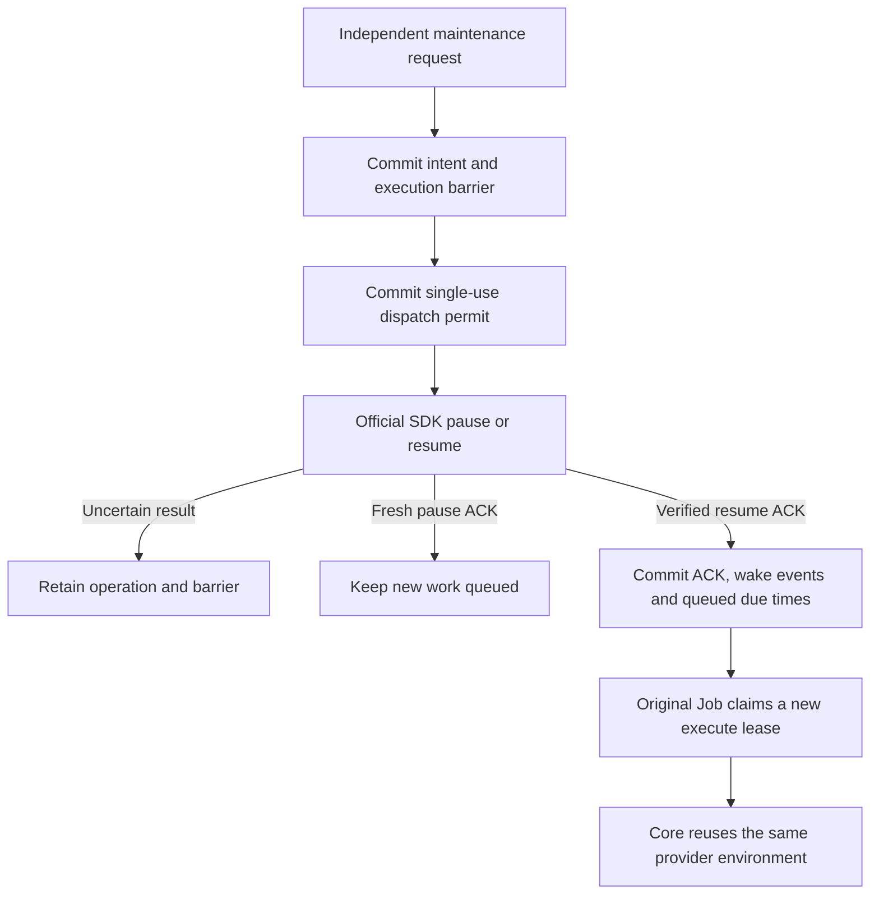

# E2B execution integration

The hosted product reuses the official E2B SDK for environment lifecycle.
Centaeris owns task admission, queueing, authorization, cancellation intent,
cleanup obligations and delivery. Core remains the authority for the native
Agent's tools, events, checkpoints and continuation. E2B owns its sandboxes,
physical admission and snapshot implementation.

E2B is an internal execution backend, not a user-facing feature. Product UI,
status and errors describe environments, workspaces, Runs, scheduling and
pause/resume. Keep provider/SDK/orchestrator names in internal configuration,
architecture documentation and diagnostic evidence, rather than presenting them
as product capabilities.

This work is limited to hosted lifecycle with the existing Core harness.
External harness validation follows hosted acceptance. Subscription interfaces,
account sharing, billing redesign, Desktop isolation and a workflow engine
are separate work.

## Evidence status

Creation, perRun and retained execution, scoped Run cleanup, independent retirement,
and explicitly requested pause/resume are implemented through the existing Core
harness and the pinned official SDK. Automatic idle selection and demand-triggered
resume are frozen outside this change; no background idle policy is enabled.
The default remains `perRun`, with global / Workspace / ordinary Worker execution
capacity 8 / 4 / 8.

| Evidence | Current boundary |
| --- | --- |
| Earlier real-provider product builds | perRun A/B, retained A/B with Runtime restart, explicit pause/resume with queued work, and independent retirement passed on the identified builds below |
| Current affected automated checks | Runtime 684, focused Core query_loop 129, SDK adapter 122, related API 151 and required PostgreSQL 214 passed; Harbor 216 passed earlier and separately. Full release-gate failures are recorded below |
| Interrupted instrumented real-provider sample | Stopped in Run A before pause/resume with an unresolved dispatched create and no locator or settlement. After reboot the tmpfs PostgreSQL ledger is absent; its original owner record and Unknown responsibility remain preserved |
| Current isolated comparisons | Twelve lifecycle samples compare baseline and candidate, three per scenario/build; six workspace IO samples add one per case/build. All passed with confirmed cleanup. perRun, retained execution and Run-cleanup Store subspans are measured separately |
| Release and legacy-removal acceptance | TB2.1 replacement, automatic idle policy, combined saturation, the wider restart/failure matrix, full release gates and historical-duty drain remain incomplete |

The executable hashes, image digests, test counts and measurements below identify
their respective builds. Historical results do not accept later source changes;
the current isolated samples accept only their stated functional and observation
boundaries, not the complete release gate. The original Unknown and an earlier
isolated trial's Unknown remain unresolved. Their owners and duties are preserved
separately from the current successful samples.

## Current execution flow

The existing AgentRun, lifecycle Job and Core loop use a
`HostedExecutionContext` with execution, workspace and artifact ports.
The E2B factory creates the SDK context under the current signed controller
and Job lease. Bounded Run and Environment registries preserve the context,
command streams and helper-effect evidence across same-process Job yields.
Each retained successor receives a separate Run authority and command history;
only physical activity, helper uncertainty and the verified capture baseline
are shared. Reclaiming a Job
rechecks its authority before reusing the context. A physical container or a
cached context alone does not prove workspace preparation succeeded.

Core, the native harness/Agent loop and model I/O run in the Runtime container.
Tool tasks, their processes and the `/mnt/data` workspace run inside the E2B
microVM through the execution ports. E2B's orchestrator manages physical VM
placement and lifecycle; Centaeris retains product admission, queueing, Run
semantics and durable cleanup responsibility.

~~~mermaid
flowchart TD
    A["API: authorize Workspace and freeze policy"] --> B["Existing queue and lifecycle Job"]
    B --> C["Worker: one execute or control lease"]
    C --> D["Runtime: verify authority and persist provider attempt"]
    D --> E["E2B factory, Environment binding and Run registry"]
    E --> F["Official SDK: tasks and workspace in E2B microVM"]
    F --> G["Runtime Core: tool results and artifacts"]
    G --> H["Protect final SessionWorkspace"]
    H --> T["Authoritative Run terminal"]
    T --> I["Scoped Run cleanup and durable receipt"]
    I --> J["Controller release and server-checked Job completion"]
    I -->|"retained"| P["Environment binding and VM remain"]
    P -->|"independent maintenance"| R["Durable retirement intent, exact removal and settlement"]
    K["Cancellation intent"] --> C
    E --> L["Unknown: preserve identity and investigation duty"]
    L --> D
~~~

The default policy remains `perRun`, workspace `/mnt/data`, user `agent`.
Each perRun Run uses a separate sandbox; a later Run in the same Session restores the
committed workspace through the existing SessionWorkspace API and snapshot
codec. This is file continuity, not memory or process restoration.
An explicitly frozen `retained` profile supports successive Runs in the same
running sandbox and independent Environment retirement, as described below.

Core file operations, Bash and artifact publication use the E2B ports. HTTP MCP
can use its existing connection path. Declared attachments, plugin skill/CLI
file projections, lifecycle hooks and MCP stdio are rejected before provider
creation. Environment background tasks and private memory volumes remain
unsupported. The helper-only template does
not imply that host files or plugin packages have been projected into it.

The fixed template must include the execution helper, workload UID/GID 10001,
`/bin/bash`, `/usr/bin/setpriv`, `/usr/bin/head` and `/usr/bin/wc`. Filesystem
helpers execute as that workload identity. Root opens the private request before
executing the helper under the workload identity; the bounded response sink
remains root-owned. Workload files retain the same ownership as ordinary Bash
writes.

The legacy backend remains present for existing obligations. E2B startup no
longer requires Docker image inspection, the legacy host socket or its supervisor.
This routing change does not establish that the full legacy implementation can
already be removed.

## Startup and signed policy

Runtime selects E2B by default and fails startup without an explicit deployment
configuration. `RUNTIME_EXECUTION_PROVIDER=docker` selects the legacy backend.
The E2B deployment supplies these settings:

| Setting | Contract |
| --- | --- |
| `RUNTIME_E2B_PROFILE_PATH` | Absolute path to the strict, bounded profile configuration loaded once at startup |
| `RUNTIME_E2B_PROVIDER_CONFIG_DIGEST` | Public configuration/account-scope identity matching the selected profile |
| `RUNTIME_E2B_PYTHON` | Absolute trusted Python interpreter path |
| `RUNTIME_E2B_ADAPTER_PACKAGE_ROOT` | Absolute trusted adapter package root |
| `RUNTIME_E2B_REQUEST_TIMEOUT_SECONDS` | Positive transport deadline, at most 60 seconds; defaults to 20 |

The [host adapter](../../packages/e2b_adapter/README.md) pins Python SDK 2.58.0.
Runtime launches it directly with an isolated interpreter and fixed bootstrap,
without a shell or ambient Python search path. Credentials remain deployment
inputs; they are not profile fields or part of the public configuration digest.
The SDK receives explicit control-plane and sandbox-data endpoints.

The E2B advertisement uses `runtime.execution_profile.v2` with the selected
environment profile. API and Runtime validate the distinct signed
`runtime.e2b_environment_profile.v1` schema and
[shared profile fixture](../../tests/workspace/fixtures/e2b_environment_profile/v1/valid.json).
It freezes provider configuration, template/build identity, workspace, user,
network, lifetime, timeout and input-transfer budget. The template build is a
canonical UUID, passed to the SDK as `templateId:buildId`; mutable tags do not
substitute for it. Later advertisements or Worker configuration cannot replace
an Environment's bound policy. Legacy payloads, digests and signatures retain
their exact meaning.

`inputBudgetBytes` limits Centaeris input and restore traffic. It is not a
filesystem quota. The profile makes no byte, inode, PID or tmpfs hard-limit
claim. Unknown fields, duplicate fields and unsupported schemas fail explicitly.

## Provider effects and control

Before a provider effect, the business store commits the exact Environment,
Run, execution, profile, configuration and lifecycle Job identities, stable
attempt/key and responsible owner. A durable dispatch CAS grants one send or
closes a proven unsent operation. A known sandbox ID is immutable within that
attempt. Provider observations supplement this ledger rather than becoming a
second node-placement or VM state machine.

SDK action and connection retries are disabled. A timeout, empty lookup,
expired lease or expired provider idempotency window never authorizes a new
create or refund. A reconstructed Runtime can read-only attach a retained
successor after the prior Run has valid cleanup and release facts. It does not
resume or extend the sandbox timeout. An open consumer whose command streams
were lost remains pending. Verified first creation without its original live
context also remains pending; it cannot prove initial workspace preparation.
Provider idempotency is
an optional additional capability and remains unverified in the local
deployment. A client capability flag does not enable it on the server.

The adapter exposes [bounded HTTP failure categories](../../packages/e2b_adapter/README.md)
while retaining an Unknown outcome. SDK 2.58.0 discards the provider semantic
error code, so HTTP 409/422 cannot prove a particular idempotency state. The
deployed server enablement and retention window remain unverified; these
diagnostics authorize neither replay nor settlement. Loopback SDK tests cover
the adapter response, not end-to-end Runtime error presentation or real-provider
recovery.

Keep global 8 / Workspace 4 / ordinary Worker 8 as the acceptance baseline.
These are business execution limits; physical admission belongs to E2B.
A control lease does not authorize ordinary execution, create or resume.
Ordinary, short control and slow cleanup use independent adapter process
instances because the SDK shares its sandbox connection pool within a process.
Transport deadlines cover blocked stdin and response reads. Losing a response
closes that transport without replaying the request; it does not prove the
provider action stopped.

PerRun cleanup requires current signed cleanup authority. It verifies the complete
provider binding, persists the exact target and removes that sandbox through
the cleanup lane. A durable verified target avoids repeated observation before
deletion. Only proven non-dispatch or exact verified removal settles an
operation. Unresolved effects retain both budget and cleanup responsibility.
Ordinary PID signaling is not process-tree cleanup evidence.

There are three explicit receipt contracts:

- The physical provider cleanup receipt keeps a positive `operationCount` and
  requires every covered operation to be settled.
- `runtime.agent_run.cleanup_receipt.no_provider_effects.v1` proves that a
  terminal Run has no provider creation operation or unresolved responsibility
  requiring cleanup. It carries no invented sandbox, deletion or settlement
  fact. An arbitrary legacy `neverAllocated` receipt cannot substitute for it.
- `runtime.agent_run.cleanup_receipt.retained_provider.v1` binds one immutable
  `providerUseId` and digest with scope `runEffectsOnly`. Current cleanup pins
  require the original Run's commands to be closed, helper effects known,
  fixed quiescence successful and the subsequent workload process count zero.
  This proof retains the Environment and its provider creation responsibility.

All paths still require the real API controller release and server-checked
Job completion. Terminal state, provider settlement, cleanup receipt, controller
release and complete remain separate durable facts. Unknown cannot disappear
behind a successful legacy receipt or a zero-operation shortcut. A successor
Run's later legitimate allocation does not invalidate an earlier immutable
no-effects proof.

## Workspace protection and retention

The workspace port reuses the existing authorized resolve, restore, immutable
snapshot commit and uncertain-commit reconciliation protocol. Snapshot and
artifact helpers use the execution activity witness and exclusive capture
guard. Unknown mutating helper effects prevent a later runner from declaring
the workspace safe; quiescence does not erase that uncertainty.

The bridge bounds inline files to 256 KiB and command output to 64 KiB. Larger
binary files use the bounded spool protocol with a 128 MiB per-transfer ceiling,
stable file identity, byte counts and SHA-256 verification. The Core filesystem
port retains its 64 MiB binary contract. Original command streams preserve
stdout/stderr bytes, including invalid UTF-8. These transport limits are
independent of the signed input-transfer budget.

Helper stdout has its own bounded sink and exact-length check. Its reply budget
must not impose a process-wide file-size limit on restored or written workspace
files. Oversized output and nonzero helper exit remain uncertain effects; they
never authorize a successful restore, cache seed or staging cleanup.

E2B environment retention or pause and Centaeris product archives serve
different purposes. Running retained reuse keeps the existing final archive
protection policy. Idle pause and a later policy that coalesces archives only
at required protection or delivery boundaries need separate measurement and
acceptance. Conditional terminal
capture now borrows one verified descriptor/manifest from the surviving E2B
runner. A successful verified restore seeds it; rejected or unknown work cannot
retain it. A matching receipt skips the full snapshot download and canonical
spool while preserving transfer admission and current dispatch authority.
Source content is still read twice, and changed content still transfers a full
frame. The API already skipped uploads for equal descriptors.

The supported retained boundary quiesces Run work while preserving the running
VM and its files. It does not add Environment task scopes. Files, native harness sessions, memory
snapshots and online services are distinct promises. An accepted pause does
not prove full-memory preservation. Existing retained environments keep their
original obligations; the initial E2B route does not reinterpret them.

## Behavioral acceptance

| Boundary | Required evidence |
| --- | --- |
| SDK requests | Pinned SDK with isolated HTTP fixtures: exact template/build/key, zero retries after lost response or error, known identity retained and secrets redacted |
| Transport | Process reuse, bounded correlated frames, blocked-input deadline and control progress while ordinary remains blocked |
| Authorization | Strict shared Python/Rust fixtures, immutable policy, unsupported capability rejection before create and unchanged legacy signatures |
| Persistence | Real PostgreSQL first-use freeze, later defaults ignored, mismatch rollback, old grants preserved and durable unknown duties |
| Core execution | Actual API, Worker, Runtime, Core and SDK perform file/Bash operations and publish the artifact's real bytes |
| Session continuity | perRun restores committed files in a distinct sandbox; explicit retained reuses the exact sandbox with a distinct authorized Run use and no archive restore |
| Recovery | Lost create/command replies and adapter/Runtime restart preserve provider identity and duties without replaying accepted effects |
| Cancellation | Ordinary execution, Worker, HTTP, DB and SDK saturation do not prevent scoped cleanup, release and complete |
| No effects | A pre-create rejection completes through an explicit no-provider-effects receipt, actual controller release and completion checks |
| Retirement | Exact provider identity is absent and covered obligations are settled; deletion cannot hide an unknown create |
| Legacy removal | A hosted stack without the old socket, runsc or supervisor completes the same supported Core workflow after old duties drain |

Unit, PostgreSQL, real-provider and performance results remain separate.
The opt-in product test uses the actual lifecycle and Core tools with a
deterministic loopback model rather than an external model request. It uses
explicitly owned PostgreSQL state and preserves that state if provider duties
remain unsettled. Fixture success is not Firecracker or full product acceptance.

Earlier local Embed builds passed the core perRun functional baseline through
the actual API, Worker, Runtime, Core and pinned SDK. Run A commits its workspace
and deletes its sandbox; Run B in the same Session uses a distinct sandbox,
restores A's files, modifies them and publishes its own artifact. The test
verifies downloaded artifact bytes and hashes, provider removal settlements,
positive cleanup receipts, API controller releases, successful Jobs and exact-ID
provider NotFound responses. Both sequential sandboxes are removed and no
provider obligation remains pending. Filesystem helpers run under the workload
UID/GID, preserving snapshot ownership safety.

A separate real-provider case verifies cancellation of the original Run after
Runtime stops: API cancellation advances through Worker control, exact cleanup,
release and complete, followed by exact-ID provider NotFound. Combined
saturation, the wider failure/restart matrix and the final release gate remain
incomplete. Explicit pause/resume has separate historical evidence below;
automatic idle policy remains deferred. This functional baseline establishes neither a
latency SLO nor incremental snapshot performance, and does not authorize legacy
removal.

### Running retained acceptance

Migration 19 adds an immutable Environment-to-creation binding, separate Run
uses and retirement intents. Original creation identity remains provenance;
each successor uses its own signed controller epoch, lease and logical
execution ID. Old signed data is preserved without inferring historical
retention. Preparation and cleanup take the local Environment guard before the
Run guard and current store pins. Only a positive factory reuse result skips
archive restoration. Retirement requires a separate maintenance token, the
released Environment epoch, valid cleanup and release facts for every use,
and exact verified provider removal. The durable retirement intent precedes
deletion; API profile resolution and execute-controller admission check it
under the same Environment row lock. The admission race has source and
component evidence; a two-connection API-versus-retirement race is not yet run.

The real Core A/B fixture passed on an earlier retained-lifecycle build after an
initial functional pass. This identified historical sample used SDK
2.58.0, Runtime executable SHA-256
`2eaa44ba2843136311a422c62cebd609e944743aa7c413a02c1ce3b06e699006`
and template digest
`dc05f652df4d1d28eb6af6234478021b9f92fafa0eb2373be737ffc386d159e9`.

| Measured boundary | One sample |
| --- | ---: |
| Run A lifecycle | 4,417.037 ms |
| Runtime restart | 390.050 ms |
| Run B lifecycle | 4,248.182 ms |
| Independent Environment retirement | 390.252 ms |
| Test case / invocation including database setup | 10.900 s / 21.203 s |

A and B used distinct use records and logical execution IDs, with the same
VM, instance and immutable creation metadata. A `/tmp` marker verified guest
file continuity outside the workspace archive. Both Runtime stdout streams
drained completely; bounded observations included successful full captures for
both Runs without dropped records, and no B Session restore, download or apply
record. Each Run reached a valid scoped cleanup receipt, API release and Job
completion. Ordinary authority was denied retirement; separate maintenance
authority removed the exact sandbox, and historical receipts remained readable.
Pending creation and use counts reached zero before the owned database was
removed. This unoptimized functional sample is not comparable with the release
benchmark below and establishes no latency distribution or SLO.

For that retained-lifecycle build, the provider PostgreSQL suite passed 72 tests
before the final prior-receipt check. Its final candidate passed all 26 retained
PostgreSQL tests, including
two new negative tests for unbound prior receipt/use/quiescence facts. API (40),
SDK (101), Core `query_loop` (129), ordinary Runtime (624 passed, 286 ignored),
and Runtime Clippy across all targets passed. All 194 required PostgreSQL test
identities exist in the 910-test executable. Ignored tests and the remaining
public release gates are not covered by ordinary Runtime test success.
Attach or context construction failure after a Run use is bound remains a fail-closed recovery
obligation; automatic recovery of that missing context is not accepted. Automatic product
idle policy is deferred. Workload-scale memory reclamation, combined saturation,
Harbor/TB2.1 and legacy removal remain separate acceptance boundaries. The diagnostic below
measures one provider pause and does not satisfy those product gates.
The perRun default is unchanged.

### Durable provider pause and resume

`POST /internal/environments/power` requires the distinct maintenance token
and an explicit retained profile. The strict `runtime.provider_environment.power.v1`
request binds `operationId`, `action`, `environmentId`, `creationAttemptId`,
`sandboxId`, `providerConfigDigest`, `expectedControllerEpoch`, and an explicitly
nullable `predecessorOperationId`. A cycle starts with pause and then alternates
using the latest acknowledged operation as its predecessor. A historical ACK is
an immutable operation result, never a claim about the provider's current state.

Migration 20 adds a durable operation journal and the derived
`runtime.provider_environment_power_admission` view. The intent commits before
an independent dispatch CAS can produce a one-use permit. The physical callback
holds the released Environment epoch and validates the original creator and all
consumer cleanup/release facts. A fresh dispatch discards the old live SDK handle;
ACK replay preserves a successor's handle. The existing slow cleanup budget
bounds provider calls while short cancellation and heartbeat capacity stays
separate. No ordinary execution capacity is added.

New work can freeze its profile and queue while paused. A valid current execute
claim receives the exact `waiting/environment_power_pending` disposition before
any controller epoch or execution grant is issued. Worker yields that same Job
without a failure retry; the existing 30-second deadline bounds lost
notifications. A fresh resume ACK atomically writes operation-scoped durable
wake events and advances eligible queued Jobs, using existing PostgreSQL ready
notifications. If the ACK precedes yield, existing yield logic consumes the
pending wake. Active owners retain their lease and reclaim lower bound.

A timeout, malformed reply or `changed=false` pause stays pending. The pinned
SDK maps general HTTP 409 conflicts to false, so this is not proof that this
request paused successfully. Unknown operations are not automatically resent,
reversed, settled by inspecting current state, or bypassed by retirement. A
process crash after the send marker commits can therefore retain a responsibility
even if no request was sent. Prepared operations can continue after restart;
committed ACKs replay without provider mutation or another wake.

Fresh pause requests use `full`; no result claims an observed provider pause
mode, snapshot generation or general RAM preservation. The platform must be the
exclusive lifecycle writer for these provider identities. External pause/resume
or provider timeout actions need their own coordinated policy before they can
participate in this protocol. Normal provider pause semantics are documented by
[E2B persistence](https://docs.e2b.dev/sandbox/persistence#pausing-sandbox).

Deploy migration 20 before the matching API, Runtime and Worker consumers. Old
creation, use, cleanup, authorization and signature bytes are preserved; no
historical pause is inferred. Automatic idle selection, demand-triggered resume,
large-workload resource reclamation, physical snapshot IO and the full
admission-versus-power race matrix remain separate acceptance boundaries. The
ordinary 8/4/8 limits and perRun default remain unchanged.

The real API / Worker / Runtime / Core / SDK power fixture passed on an earlier
explicit-power build against local Embed using SDK 2.58.0 and Runtime executable SHA-256
`48b954f54d529dfd56b564afed6ed5bd81b1a44f96a6d57ca12de85a7a5094c0`.
The product image manifest was
`3b5509dd5a5ddea107c9e20410562b85af0792c13da9d3a9f4137017d8f27c60`;
the template digest was unchanged from the retained acceptance above.

| Observed boundary | One functional sample |
| --- | ---: |
| Run A lifecycle | 4,520.665 ms |
| Full pause HTTP request | 503.200 ms |
| Runtime restart while paused | 403.484 ms |
| Full resume HTTP request | 631.931 ms |
| Runtime restart after resume | 421.728 ms |
| Run B lifecycle | 5,098.481 ms |
| Independent retirement HTTP request | 385.004 ms |
| Test case / invocation including database setup | 13.703 s / 24.118 s |

The pause/resume spans use one local monotonic clock and include HTTP, durable
Store operations, adapter startup and SDK validation/mutation. They are neither
provider-only latency nor time to the first useful tool; this debug functional
sample establishes no latency SLO or 300 ms target achievement. The first
successful B `read` result was recorded with its original Core event timestamp,
but its clock was not correlated with the HTTP clock for a stage-duration claim.
The resume ACK and exact Job wake event shared one transaction and database
clock (`1792721407962` ms); that fact does not imply zero notification latency.

B was admitted while paused, yielded its original Job to a 30-second fallback,
and was made due by the fresh resume ACK without waiting for that deadline.
B bound no provider use and emitted no tool/model execution before resume.
It then used a distinct signed use and logical execution in the same VM,
verified the workspace and `/tmp` marker, and completed cleanup, release and
Job completion. Historical pause ACK replay left the resumed VM running.
Three Runtime streams drained without lost observations; both terminal captures
were positively observed and B performed no archive restoration. Ordinary
internal authority was denied pause and resume. Exact-ID provider NotFound and
zero pending creation, use and power counts allowed the owned database to be
removed. This fixture validates filesystem continuity; it does not validate RAM
preservation, physical memory release, snapshot bytes or block IO.

For that explicit-power build, the 14 new PostgreSQL cases passed, including
Unknown/no-resend, immutable
history, forward migration, fresh dispatch visibility and Environment row pins,
predecessor cycles, and all three resume/yield/replay wake cases. The affected
provider suite initially passed 87 of 88; its remaining historical migration
assertion expected schema 19, was updated to 20 and passed a focused rerun.
No production change followed that suite. Runtime tests passed 635 with 300
ignored, Core `query_loop` passed 129, and all-target Runtime Clippy passed.
SDK adapter (103), API contract/guard (44), and Worker lifecycle (53) focused
tests passed. All 208 required PostgreSQL identities exist exactly once in the
935-test executable. Those registry and ordinary-test checks do not execute the
other ignored release gates. Source parity for that build compared 201 Rust
compiler-image files and 398 product-image Python/configuration files with its
candidate; all matched, and both images contained the same Runtime executable.
Those checks predate the later timing and recovery changes.

### Cleanup after retained preparation failure

A missing Run use is not evidence that provider effects are absent. If the
original retained creator has a dispatched operation and an exact late locator,
Runtime uses the existing Store cleanup verification and use-recovery methods.
It verifies the immutable provider target under current cleanup authority,
recovers only that creator's logical execution, and invokes fixed quiesce and
process-state helpers inside the existing cleanup pins. A temporary transport
uses only the control SDK lane and denies ordinary execution authority. A
confirmed receipt covers `runEffectsOnly`; the environment remains charged
until a separately authorized retirement verifies its removal.

A dispatched creation without a locator remains Unknown without launching an
adapter. A successor failing before its use is registered cannot borrow the
creator's cleanup or refund/delete the shared environment. Superseded creator
authority is rejected after a successor takes control. An existing open use
without its original execution context remains pending: creating a fresh empty
command registry would erase uncertainty. This also bounds recovery after a
crash between recovered-use commit and quiescence/receipt commit. A closed
receipt may replay under current authority without another provider operation.

The focused Runtime/PostgreSQL recovery fixtures exercise exact late-target
verification, denied ordinary dispatch, creator-only cleanup, independent
retirement, stale creator and successor rejection, and preservation of an open
consumer or an Unknown quiescence result. They use a controlled provider; they
have not recovered the unresolved real-provider create described below.

### Provider power timing and interrupted acceptance

Power timings are optional observations enabled by
`WORKSPACE_PERF_OBSERVATIONS=1`. The public power request and result schemas,
one-dispatch permit, authority checks and Unknown handling are unchanged.
Only the observed power child receives `CENTAERIS_E2B_POWER_OBSERVATIONS=1`;
ordinary creation is not instrumented by this path. Observations cannot turn
an uncertain provider effect into an ACK or settlement.

The bounded `workspace.perf.v1` records use `phase=providerPower`, the parent's
`operationId`, `action`, `source`, a closed metric name, finite nonnegative
milliseconds, a closed outcome and `atUnixMs`. They contain no provider locator,
configuration, request body or diagnostic text. Python emits the internal
`runtime.e2b.power_timing.v1` wire on stderr; Rust validates its exact fields,
values and correlation before assigning the parent operation identity. An
oversized or invalid line is discarded while the pipe continues draining.
The forwarding limit is 64 candidate records and 2 KiB per line. Clock,
writer and observation failures preserve the business result and IPC stdout.

| Boundary | Metrics |
| --- | --- |
| Store journal and transaction work | `storePrepareElapsedMs`, `storeDispatchCasElapsedMs`, `storeSideEffectPinsElapsedMs`, `storeCallbackElapsedMs`, `storeAckCommitElapsedMs`, `storeAdvanceElapsedMs` |
| Runtime lifecycle | `runtimePowerElapsedMs`, `contextDropElapsedMs` |
| Python adapter transport | `adapterSpawnElapsedMs`, `adapterHandshakeElapsedMs`, `adapterRoundTripElapsedMs`, `adapterCloseElapsedMs` |
| SDK startup | `sdkImportElapsedMs`, `sdkClientSetupElapsedMs` |
| Provider operation | `sdkIdentityGetElapsedMs`, `sdkPauseElapsedMs`, `sdkConnectElapsedMs`, `sdkResumeVerifyGetElapsedMs`, `sdkHandleElapsedMs` |

These durations overlap. `storeAdvanceElapsedMs` includes the Store stages and
callback; `runtimePowerElapsedMs` includes the outer lifecycle and adapter close.
The adapter close is outside Store advance. SDK handle records cover two calls,
capabilities and the actual operation. SDK pause and connect measure SDK calls,
not pure HTTP round trips. The observation code adds no provider requests:
pause retains GET + POST, and resume retains GET + POST + GET, without retries.
Nested metrics must not be summed as independent costs.

The acceptance collector requires all 12 Runtime metrics and five SDK metric
names for a fresh pause, or six SDK metric names for a fresh resume. SDK handle
has two records. An ACK replay requires only prepare, advance and Runtime power.
A Runtime power record does not end collection: late SDK records remain eligible
until that Runtime stream drains. Replay bindings are distinct from fresh
invocations. Missing values are not zero; missing/excess metrics, foreign or
dropped records, ambiguous late records and incomplete streams make coverage
incomplete.

The first instrumented product sample stopped in Run A before pause or resume.
It used product manifest
`68554270fa5cb5186d0dfeba8702169e014eb3259f6ab89dc6d522fd6f69a9ed`
and Runtime executable
`2a4bf36b6df037459180a898a83be0bdd5501eecd340c9cb44f53a5be5848f1e`.
Its creation operation remained dispatched without a reported or verified
sandbox, settlement or Run use. The Run recorded a pre-admission failure;
the lifecycle Job remained running. The owned test database and ownership
record were initially preserved. No second or third sample was started in that
invocation, and this build has no real pause/resume stage-duration result.
After reboot, the original database was absent because the PostgreSQL data
directory was mounted on tmpfs; the original owner record remains unchanged.
Loss of that ledger is not proof of provider non-creation, cleanup or settlement.

Read-only investigation correlated the creation timestamp with provider API
listener failures before and after that timestamp. It found no matching
provider Redis record or ClickHouse sandbox event/log. Those observations do
not establish the actual SDK send/result boundary or prove non-creation.
The original adapter error was not persisted in the pre-admission receipt,
and the original fixture folded claim, start, execute and observe exceptions
into one error without refreshing state. The current fixture distinguishes those
four stages, refreshes the latest Run/Job state when available, and emits bounded
static error categories and safe workspace diagnostics. It preserves the primary
failure when observation itself fails and does not expose raw exception values.
That diagnostic correction cannot reconstruct the earlier lost provider result.
Service recovery, an empty lookup or timeout expiry cannot settle this dispatched
operation. A candidate locator
must be attached to the original immutable attempt and verified against its
creation metadata, environment and provider configuration before cleanup can
proceed through current authority. If no locator or authoritative operation
result is recoverable, keep the original responsibility pending. The missing
original ledger cannot be reconstructed from an empty provider lookup. A
separately owned isolated scheduling/timing sample is authorized with a distinct
owner and database; its results must remain separate from the unresolved original
attempt and must not delete, refund, settle or replace that original owner.

Before the subsequent recovery changes, source parity matched the timing
compiler's 204 Runtime and 166 Core files plus root Cargo files, and the
product's 368 API, 14 adapter and 17 Worker Python files in both directions.
Both images had the same executable and 954 test identities. All 210 required
PostgreSQL identities were unique and present. The final product's 16 power
PostgreSQL tests executed and passed once, with zero ignored tests, using an
independent mock-provider database that was removed after the gate. These
checks validate the identified build; they do not accept the interrupted real
lifecycle or later source changes.

Automatic idle policy remains unimplemented and frozen outside this change.
Future work must be configurable and explicitly opt-in, with deterministic clock
and controlled-provider tests. Resume admission must be bounded by business
execution capacity before queued demand can trigger power operations. The original
sample remains blocked and has no completed stage timings. Its provider API
listener failures did not establish the actual create send/result boundary.
The separately owned completed samples below provide current-build observations
without settling the lost original ledger. These measurements inform later work;
they do not authorize removing identity validation or changing provider request
counts.

### Historical isolated lifecycle scheduling samples

The preceding `perRun` and explicit retained-power samples passed on commit
`da37ef714f73cfa508c4bab03efe6404c4de5494`, source tree
`dddc6711b3691dd52643c3469fed37e9c518638d`, product image
`sha256:9f739ba78c5d4e23bdbbb863421d2f6f4dc0f7eead48af30286dbbbcce4b645a`,
and Runtime test executable SHA-256
`a667a28f256fee86d8cb1e66a889d48166998389f2bb781e4854b704aab9d7c8`.
Both used the same Debug test-profile executable with `debug=0`, `opt-level=0`,
SDK 2.58.0 and a 512 MiB diagnostic sandbox. Their local report identifiers are
`6fa86dce84fd43a5bbb368f73ee0fcba` (`perRun`) and
`78945a45883743169688a15ad4d77e95` (retained power). Full child output, original
structured reports and resource JSONL remain OS-temporary measurement artifacts.
These are one sample per scenario, not a latency distribution or an optimized
release-build benchmark.

The perRun sample completed A, protected its workspace and removed its VM. B in
the same Session used a distinct VM, restored A's committed files, performed the
real Core read/Bash/artifact workflow, and completed its own cleanup and release.
The power sample completed retained A/B, explicit pause/resume with a queued B,
Runtime restarts, Run cleanup/release and independent Environment retirement.
Both verified exact provider absence and zero outstanding duties before removing
their independently owned state; the original Unknown owner bytes were unchanged.

| Observation coverage | perRun | Retained power |
| --- | ---: | ---: |
| Lifecycle calls, all `ok`, none in flight | 26 | 33 |
| Bound Run startup profiles, complete | 2 | 2 |
| Adapter span records, no invalid/foreign/dropped/oversized/error observations | 273 | 272 |
| Explicitly unassigned adapter spans | 0 | 12 |
| Central adapter method calls / spawn-plus-handshake spans | 261 / 12 | 258 / 14 |

The power transport collector's own coverage is `incomplete` solely because its
12 independent pause/resume/retire spans have no bound Run. The report retains
that status and explicit `unassigned` attribution; it does not infer Run ownership.
The enclosing measurement check accepted observed, loss-free transport with that
stated boundary, complete lifecycle/startup/power observations, and successful
first-read receipts. All observation loss/error counters were zero.

#### Same-Session VM turnover and useful-tool bounds

The perRun product record supplies the A/B roles; startup records are mapped by
those Run IDs, not by lexical record order. B's first verified tool was the real
`read`, call `e2b-1-0`, with a successful Core result.

| Collector-clock interval | Observed ms | Interpretation |
| --- | ---: | --- |
| perRun A lifecycle complete to B's first-tool follow-up | 2,268.687 | Upper bound including intervening fixture artifact/session checks, public admission, new VM and first-read result persistence/model callback transit |
| perRun B admission request to accepted response | 65.640 | Public enqueue HTTP interval including client/server work |
| perRun B accepted response to first-tool follow-up | 2,146.512 | New Run scheduling/startup and verified first-read follow-up upper bound |
| Retained resume response to B's first-tool follow-up | 2,311.055 | Upper bound including the deliberately forced post-resume Runtime restart and fixture checks |
| Retained resume response to first subsequent step return | 4,934.420 | Upper bound including that whole returned step |

Each interval uses two markers from the same fixture monotonic clock. The
follow-up marker is arrival at the next model callback after the tool, not its
exact completion time. The Core tool's own latency was 97 ms for perRun B and
95 ms for retained B; those Core clock records are not correlated with the
collector, database, Linux sampler or Windows wrapper clocks. Do not subtract
those clocks. Neither admission interval nor adapter RTT measures pure network
RTT. The 2.147 s perRun and 2.311 s retained intervals have different start
conditions and forced-restart work, so they do not establish which policy is
faster. Exact first-tool availability, representative repeats and percentiles
remain unmeasured.

| Rust startup or adapter boundary | perRun A | perRun B | Retained A | Retained B |
| --- | ---: | ---: | ---: | ---: |
| Startup total ms | 1,010 | 1,062 | 831 | 730 |
| Sandbox ensure ms, nested within startup | 919 | 638 | 743 | 583 |
| Workspace restore stage ms | 34 | 290 | 33 | 0 |
| Session-start commit ms | 28 | 112 | 28 | 119 |
| Adapter create / attach RTT ms | create 332.192 | create 103.491 | create 113.965 | attach 26.596 |

The startup profiles use existing Rust `Instant` elapsed stages. Sandbox ensure
includes adapter setup/handshakes and lifecycle work; adapter RTTs measure the
Runtime-to-adapter request/result boundary, not provider-internal VM creation.
Startup, handshake, capabilities and method spans overlap and must not be added.
Retained B verified no archive restore. Its startup includes fresh authorized
attachment after Runtime restart, not a second create.

#### Explicit power cost boundaries

| Nested span | Pause ms | Resume ms |
| --- | ---: | ---: |
| Full HTTP request | 527.256 | 608.166 |
| Runtime power, including adapter close | 510.251 | 590.149 |
| Store advance | 501.742 | 586.840 |
| Store prepare / dispatch CAS / side-effect pins | 39.662 / 35.877 / 27.882 | 93.790 / 35.763 / 28.578 |
| Store callback / ACK commit | 389.824 / 6.993 | 414.221 / 13.209 |
| Adapter handshake, including SDK startup | 275.680 | 290.614 |
| SDK import | 227.544 | 240.853 |
| SDK identity GET | 18.535 | 18.490 |
| SDK pause / SDK connect | 86.964 | 100.557 |
| SDK post-resume verification GET | not applicable | 2.228 |
| Adapter round trip / close | 106.154 / 8.308 | 121.955 / 3.088 |

Fresh pause/resume each started a new SDK child; SDK import alone exceeded the
provider SDK mutation interval. The acknowledged historical pause replay took
5.857 ms in Runtime, emitted only prepare/advance/Runtime observations, and made
no SDK mutation. These nested boundaries identify cold child/import overhead,
not additive costs or pure provider HTTP/physical snapshot IO. The retained Run
A/B lifecycle intervals were 5,124.223 / 5,002.803 ms; paused/post-resume Runtime
restarts were 423.121 / 412.876 ms, and independent retirement HTTP was 417.057 ms.

| Lifecycle request category | perRun count / sum ms / max ms | Power count / sum ms / max ms |
| --- | --- | --- |
| Runtime step | 2 / 9,238.677 / 4,668.948 | 2 / 8,772.942 / 4,448.215 |
| Runtime teardown | 2 / 1,045.507 / 567.570 | 2 / 379.962 / 191.290 |
| API resolve | 4 / 338.454 / 90.939 | 5 / 402.181 / 87.411 |
| API release | 2 / 195.875 / 100.589 | 2 / 226.953 / 114.581 |
| API project | 4 / 167.552 / 61.454 | 4 / 164.728 / 60.752 |

Each sum is local to its endpoint category. Nested Worker/API/Runtime/power work
overlaps, so these rows cannot reconstruct lifecycle elapsed time by addition.
The retained fixture has one deliberate wait/yield before resume; neither sample
is a natural two-slot task pipeline or an eight-execution saturation trial.

#### Helper requests and small-payload amplification

The final workspace collector reports unique operations, not cumulative reports
printed at intermediate Runtime stops. PerRun has one `terminalCommit` capture
for A and one `sessionRestore` plus one `terminalCommit` for B. Retained has one
`terminalCommit` per Run and no B archive restore. There were no additional
observed capture operations hidden behind the helper request count.

PerRun recorded **15 framed helper invocations per Run**, not 15 captures. In
`E2bSdkTransport::helper_frame`, every successful ordinary frame uses a staging
mkdir (`runCommand` + `waitCommand`), upload, helper command (`run` + `wait`),
download and staging cleanup (`run` + `wait`): eight central method calls.
Thus 15 frames explain 45 run/wait pairs plus 15 uploads and 15 downloads per
Run. The one real Bash command adds the 46th run/wait pair. Across both Runs,
those 244 method calls plus six capabilities, two creates, two kills and seven
control-helper calls account for all 261 central calls. Six process spawns and
six handshake spans bring the observed span count to 273. The existing span
schema does not label each ordinary helper kind, so its remaining helper-kind
breakdown cannot be inferred from capture metrics.

The power sample had 15 frames for A and 14 for B: 89 run/wait pairs, 29 uploads
and 29 downloads in total. Retained B avoided the restore frame. The full 258
central calls include independent maintenance, and 14 spawn/handshake spans
bring the total to 272. A capability call is nested in its handshake; a recorded
method call is not necessarily one wire-level provider HTTP request.

| Unique terminal capture | perRun A | perRun B | Retained A | Retained B |
| --- | ---: | ---: | ---: | ---: |
| Logical source bytes / source-read bytes | 30 / 60 | 73 / 146 | 30 / 60 | 73 / 146 |
| SDK frame / raw capture spool bytes | 618 / 618 | 804 / 804 | 618 / 618 | 804 / 804 |
| Canonical Runtime spool / consumed upload-body bytes | 367 / 850 | 553 / 1,036 | 367 / 850 | 553 / 1,036 |
| Capture / upload / full workspace commit ms | 96.717 / 60.044 / 322.985 | 94.558 / 62.878 / 326.893 | 93.852 / 62.713 / 318.126 | 93.709 / 64.310 / 326.858 |

Source reads are exactly 2x logical bytes. Frame/logical ratios are 20.60x for A
and 11.01x for B; consumed multipart upload-body/logical ratios are 28.33x and
14.19x. These tiny payloads expose framing/control metadata, not extra source
content, durable provider bytes or physical IO. PerRun B's restore downloaded
the canonical 367-byte archive into the Runtime spool; its measured download
and sandbox apply intervals were 0.073 / 100.435 ms, nested inside the 290 ms
startup restore stage. Physical provider IO and partial SDK staging are unmeasured.

#### Host resource observation and HugeTLB capacity

The earlier host-capacity fault was addressed by expanding the local 2 MiB
HugeTLB pool from 512 to 768 pages (1,024 to 1,536 MiB). This changed environment
capacity, not product behavior. Both preceding samples used the fixed 768-page
pool; their 512 MiB sandbox does not validate Terminal-Bench 2–8 GiB tasks.
The single WSL sampler collected 119 frames over 29.500 s for perRun and 123
over 30.500 s for power at 250 ms intervals. Maximum per-frame read windows were
6.469 / 4.624 ms. The following states use only each sampler's monotonic clock;
labels describe inferred host resource states rather than exact ACK times.

Let `T`, `F`, `R`, and `P` denote HugePages_Total, HugePages_Free, HugePages_Rsvd
and Hugepagesize. Pool backing in use is `(T-F)*P`, future-fault reservation is
`R*P`, used-plus-reserved capacity is `(T-F+R)*P`, and free capacity available to
new reservations is `(F-R)*P`. Reserved-for-fault is not already mapped memory.

| Sample and resource-state window, seconds from its sampler start | Pages T / F / R | Used MiB | Reserved-for-fault MiB | Used + reserved MiB | Unreserved free MiB |
| --- | --- | ---: | ---: | ---: | ---: |
| perRun A stable, 19.00–21.75 s | 768 / 555 / 343 | 426 | 686 | 1,112 | 424 |
| Between perRun VMs, 22.00–22.75 s | 768 / 646 / 178 | 244 | 356 | 600 | 936 |
| perRun B stable, 24.75–27.50 s | 768 / 555 / 343 | 426 | 686 | 1,112 | 424 |
| Retained A stable, 17.50–21.50 s | 768 / 555 / 343 | 426 | 686 | 1,112 | 424 |
| Paused-type interval, 21.75–22.75 s | 768 / 646 / 178 | 244 | 356 | 600 | 936 |
| Retained B stable, 25.25–28.75 s | 768 / 555 / 343 | 426 | 686 | 1,112 | 424 |

Both transitions return 512 MiB of reservable capacity: 182 MiB less used backing
plus 330 MiB less future-fault reservation. The entire 1,536 MiB pool remains
reserved from the normal allocator. These host-wide differences include other
consumers and do not prove that 512 MiB was returned as ordinary host RAM or that
full guest memory/process state was preserved.

| Host-wide resource observation | perRun | Retained power |
| --- | ---: | ---: |
| Busy CPU core-seconds / observed capacity utilization | 49.480 / 20.15% | 50.150 / 19.69% |
| Matching Firecracker CPU, observed lower bound core-seconds | 1.880 | 1.830 |
| Sampler CPU-seconds | 0.480 | 0.495 |
| Peak normal non-available MiB | 3,220.207 | 3,207.992 |
| Peak normal non-available + default HugeTLB used MiB | 3,646.207 | 3,633.992 |
| Peak Firecracker ordinary RSS MiB | 3.176 | 3.051 |
| `sdd` read / write MiB | 44.844 / 103.312 | 0.004 / 397.379 |
| Separate network-block devices, read / write MiB | `nbd5` 5.207 / 0; `nbd6` 5.164 / 0.148 | `nbd7` 4.980 / 0; `nbd8` 2.801 / 0.172 |

Normal non-available is `MemTotal - MemAvailable - Hugetlb`. Its derived sum with
default-pool used pages excludes unused reserved backing and is not total physical
host consumption. Ordinary RSS excludes the separate guest HugeTLB mappings.
Firecracker process IO was unavailable; process exit tails and entirely
between-frame processes can be missed. Device counters are host-wide, include
setup/database/background and sampler/output work, and may overlap across device
layers: do not sum them, attribute them to a VM, or derive snapshot write
amplification. No background baseline was subtracted.

#### Candidate gates and acceptance limits

On that preceding build, affected checks passed: 658 Runtime tests, 129 focused Core `query_loop`
tests, 112 SDK adapter tests, 130 related API tests, and all 214 required
PostgreSQL tests. Each required PostgreSQL identity appears exactly once in the
compiled fixture executable. The separate Harbor Python suite passed 216 tests.
These are separate behavioral/registration results, not a complete release gate:
the full Windows Core gate encountered LLVM out-of-memory, installed Node
24.19 does not satisfy the required 22.21 toolchain, and the hosted native gate
was interrupted and did not pass.

The original pre-reboot dispatched Unknown remains unresolved with its owner
unchanged and its tmpfs ledger absent. The earlier independently owned trial
with database suffix `a9ff586a…` also retains its Unknown responsibility and
owner. Neither is deleted, refunded or settled by these new zero-duty samples.
Malformed or incomplete older call reports were not repaired, combined with
these records, or used as current timing evidence.

Both preceding results use deliberately serial deterministic model fixtures, with
explicit checks and forced Runtime restarts in the power case. They accept only
the described lifecycle and observation boundaries. They do not accept automatic
idle selection/resume, eight concurrent executions, a full admission queue,
fairness, combined saturation, full-memory preservation, 2–8 GiB task sizing,
GPU execution, p99/SLOs, or the complete release/legacy-removal gate.

The existing Harbor runner can supply the later natural pipeline: its FIFO
`Admission` reserves declared memory/CPU/storage vectors for at most two trials,
keeps 8 GiB-or-larger tasks exclusive, and holds allocations through setup,
verification, artifact collection and confirmed cleanup. Those existing rules
are reusable; the E2B provision/template resource mapping, task-specific 2–8 GiB
or GPU environments, setup and independent verifier handoff are not connected.
The current helper-only 512 MiB template and these serial A/B samples do not
validate that two-slot Terminal-Bench pipeline.

### Current authority and lifecycle comparison

The current production candidate is commit
`07fb38b248800e959881146db361b9e7270a1a6d`. It adds explicit parameter types to
14 controller-authority queries so PostgreSQL can prepare and execute each in
one protocol send. SQL, parameter order, lock order, post-lock expiry checks,
timeout restoration, grant validation and before/after callback revalidation
remain unchanged. It adds no authorization cache. Characterization coverage
passed before and after this behavior-preserving change.

| Build | Source tree | Image digest | Runtime executable SHA-256 |
| --- | --- | --- | --- |
| Baseline: `8122ee87` production code plus characterization tests | `78b4f6c980f4ef2f5a80d34f9551b803dc117481` | `3f4c743ee34059b9f2004abe27c3df07979c7141dba5da1e155849b53f869805` | `448739a1491471a6325b6671864fe4c17410b16e5e23a69d20f1ca47b1d6e86a` |
| Candidate: `07fb38b2` | `19a5e267e808d4e06aa183b506f2ec8caf2db5da` | `db364e9bb78ead6bdb2ca9ca4fe1038f1f685cf795ed2caa33a08dac21fb7517` | `c84380cef9d49f0919fe4fced769a3edf80d6dd60b6cd9e690983125ce7ad8af` |

Both use SDK 2.58.0, the same 512 MiB diagnostic template (identity digest
`dc05f652df4d1d28eb6af6234478021b9f92fafa0eb2373be737ffc386d159e9`), and the
Debug test profile (`debug=0`, `opt-level=0`). Global / Workspace / ordinary Worker
execution limits remain 8 / 4 / 8. Three samples per build and scenario alternate
baseline/candidate, one live sample at a time, after build and database gates
finished. These are descriptive repeats, not p99/SLO or release-profile results.

All twelve completed Core read/Bash/artifact execution, Run cleanup, release,
exact provider absence and zero outstanding duties. perRun rotates distinct A/B
VMs in one Session. Explicit retained power reuses A/B, preserves queued work,
pauses, resumes, survives deliberate Runtime restarts and retires independently.
Both earlier Unknown owners remain byte-for-byte unchanged and unresolved.

| Scenario / build | OS-temporary report IDs, sample order |
| --- | --- |
| perRun baseline | `45af56035f3045b3a67145cfac2a1c0e`, `8a63cf3455964d0c9d8b0283d0b046ab`, `b87020fca1ef4453b78d36d6026541d6` |
| perRun candidate | `073224d38d0048d895e03f94b06ac547`, `8f38ec44b2a549cd956c024022ee8150`, `698d6af8b2df4080b4c3f0c355181ad7` |
| Retained power baseline | `33a5df61189d47ecb4198333156f9fb1`, `0cf2cd5d8bb94828844d55d5889c7331`, `494ff4cb67844eb089bfe8bb9f654fbc` |
| Retained power candidate | `dca03380aecd4646bb4cf4957a4a4d76`, `216c12acbdd34f5690b5a2b1c237a5d2`, `ee638c96b75f48bba69ae069ff20a47d` |

#### Clock and attribution boundaries

Fixture markers and receipt milestones use Linux `CLOCK_MONOTONIC` only after
matching the boot-ID/time-namespace clock-domain digest. Receipt ready means
Core's successful DurableReceipt safe point; committed means acceptance of the
existing tool-record commit, before downstream transcript work. Neither is raw
tool return or a rendered timestamp. Core tool duration is separate. Wall clocks
and emission times are never subtracted to invent intervals.

Startup, transport and execution loss/invalid/foreign/interrupted/binding-error
counters are zero. perRun has 494 explicitly unassigned SDK observation records
per sample; power has 481. These are diagnostic records, not counts of provider
requests. Startup may retain its actual child-spawn owner; requests in shared
SDK children remain unassigned. Raw execution attribution therefore stays
`incomplete`, while the strict wrapper confirms loss-free observation. This is
not complete per-Run SDK ownership. Resource observation gaps remain separate.

#### Store authority and remaining call expansion

`providerDispatch` now requires a closed `dispatchKind`: `perRunExecution`,
`retainedExecution` or `retainedRunCleanup`. Each has checkout, authority-before,
callback, authority-after, commit, connection-return and total boundaries. A
cleanup ACK replay emits only stages actually traversed. Missing work is never
represented by invented zero-duration spans.

Each perRun sample has 41 dispatches and 37 helpers. Each power sample has 40
retained execution and two Run-cleanup dispatches, with 39 helpers. Every helper
joins its same-Run dispatch uniquely; helper, SDK operation and transport counts
match between builds. Validation may have no helper, and one cleanup dispatch
can include multiple helpers. Cleanup authority-after includes proof validation,
receipt digest, update and readback, so it is not pure authorization cost.

The following are **min / median / max across three samples, ms**. Authority cost
is each sample's mean per dispatch of before plus after, then summarized across
samples; it is not a sum of independently selected component medians.

| Dispatch kind | Baseline authority cost | Candidate authority cost | Median change |
| --- | ---: | ---: | ---: |
| perRunExecution | 51.086 / 51.735 / 52.996 | 35.242 / 35.732 / 35.748 | -30.9% |
| retainedExecution | 49.866 / 50.361 / 51.688 | 39.058 / 39.917 / 40.374 | -20.7% |
| retainedRunCleanup | 60.503 / 60.951 / 63.049 | 48.303 / 50.207 / 50.399 | -17.6% |

The repeated authority boundary improved without reducing freshness checks or
physical operations. Store transactions and authority/use pins still span the
whole callback, including helper waits. This serial experiment does not establish
whether those pins delay cancellation or maintenance under contention.

PerRun still expands 30 bulk frames into mkdir/upload/execute/wait/download/
cleanup stages: three run/wait pairs plus upload/download, eight central SDK
operation boundaries per frame. It has 261 adapter calls / 273 transport records;
power has 258 / 272. An adapter operation is not necessarily one provider HTTP
request. Six / seven SDK imports and cold handshakes remain per sample; this
optimization does not remove child startup or change helper framing.

#### Successful tool receipt and turnover

| Boundary, ms min / median / max | Baseline | Candidate |
| --- | ---: | ---: |
| perRun B admitted to receipt committed | 1,823.075 / 1,853.183 / 1,877.035 | 1,726.777 / 1,732.728 / 1,742.449 |
| Retained resume returned to receipt committed | 2,013.045 / 2,040.447 / 4,883.981 | 1,891.057 / 1,911.206 / 1,972.423 |
| perRun independent Core read | 97 / 97 / 97 | 82 / 83 / 87 |
| Retained independent Core read | 97 / 99 / 111 | 83 / 86 / 87 |
| perRun predecessor lifecycle complete to successor model callback, upper bound | 2,327.108 / 2,350.796 / 2,372.181 | 2,186.066 / 2,207.185 / 2,207.287 |

The median admitted/resume-returned to receipt interval falls 6.5% / 6.3%.
Resume-response intervals include the deliberate post-resume Runtime restart and
exclude resume HTTP. The two scenarios cannot establish an idle-policy speedup
or an optimal threshold. Receipt ready-to-commit and callback transit remain
separate from Core's read latency.

The 4,883.981 ms baseline power result is retained. Its B fileSystem helper totals
are 1,805.380 and 780.205 ms, with prepareWorkspace 232.704 ms. The first helper
includes mkdir 479.903, command wait 564.394 and cleanup 558.664 ms. The spike is
inside helper work rather than an authority-before/after spike; these observations
do not identify its cause.

#### Creation, explicit pause/resume and retirement

In current perRun samples, the per-sample mean SDK create mutation is
107.526 / 110.602 / 118.861 ms (min / median / max across n=3); the enclosing
SDK create handle is 110.377 / 113.593 / 121.780 ms. These are SDK client/network
boundaries, not provider-internal VM boot time. B startup total is
1,013 / 1,016 / 1,017 ms, including environment ensure 607 / 615 / 621 and workspace
restore 261 / 262 / 274 ms. In retained power, B startup is 703 / 711 / 768 ms,
ensure 558 / 568 / 621 ms, with no restore. Parent/child spans overlap.

The following use **candidate n=3 medians, ms**; each row has its own observations
and nested rows must not be added together.

| Boundary | Pause | Resume |
| --- | ---: | ---: |
| Public HTTP | 555.094 | 643.515 |
| Runtime power total | 537.825 | 626.751 |
| Store prepare | 38.777 | 97.180 |
| Store dispatch CAS | 36.134 | 37.530 |
| Store side-effect pins | 28.567 | 30.124 |
| Store callback | 410.475 | 443.022 |
| Store ACK commit | 17.455 | 14.145 |
| Adapter handshake | 271.247 | 320.513 |
| SDK import within handshake | 226.106 | 256.223 |
| SDK pause / connect | 111.425 | 100.330 |
| SDK identity GET | 17.971 | 20.389 |
| SDK resume verification GET | not applicable | 2.198 |

The pause Runtime median changes 533.558 to 537.825 ms (+0.8%); resume changes
712.697 to 626.751 ms (-12.1%). SDK cold import was not changed and its variation
cannot be attributed to typed queries. Independent environment retirement's
fixture workflow is 450.580 / 452.778 / 580.994 ms baseline and
403.624 / 431.586 / 457.791 ms candidate, including its confirmed lifecycle
work rather than just the provider kill call.

#### CPU, hugepage commitments and actual device IO

The 250 ms sampler covers all host work, including other services, fixture and
database work and its own output. It does not subtract a background baseline.

| Per-sample resource median | perRun baseline / candidate | Retained power baseline / candidate |
| --- | ---: | ---: |
| Host busy CPU, core-seconds | 53.29 / 51.87 | 57.90 / 56.91 |
| Normal non-available + used HugeTLB + reserved-for-fault, same-frame peak, MiB | 4,542.367 / 4,535.914 | 4,552.449 / 4,516.465 |

Normal memory excludes the fixed HugeTLB pool. Used pages are actual backing;
`HugePages_Rsvd` represents already promised but not yet faulted pages. The
commitment formula is evaluated in each frame before taking its peak. Separate
peaks must not be added. Small host envelope differences do not prove a CPU or
memory saving caused by typed queries.

For all six power samples, stable active frames have used 430 MiB plus reserved
682 MiB, or 1,112 MiB committed. The common paused window is defined by time,
`[pause ACK + 250 ms, resume request start)`, without filtering by memory value.
Baseline windows have 2 / 3 / 2 frames and candidate windows 2 / 2 / 2. Every
frame has used 248 MiB plus reserved 352 MiB, or 600 MiB committed: pause releases
182 MiB backing plus 330 MiB promised-for-fault, **512 MiB total commitment**.
The fixed 1,536 MiB pool remains reserved from normal allocation.

Release is not immediate at ACK. Four boundary frames retain 1,112 MiB at ACK
+8 / +72 / +24 / +94 ms; subsequent frames at +258 / +322 / +274 / +344 ms show
600 MiB. All boundary frames are retained in the raw observations. A short
explicit pause therefore demonstrates commitment release but does not establish
long-idle CPU savings, a policy threshold or fleet memory efficiency.

| Host `sdd` IO, MiB min / median / max | Read | Write |
| --- | ---: | ---: |
| perRun baseline | 4.711 / 10.344 / 323.691 | 52.184 / 65.578 / 70.988 |
| perRun candidate | 0.039 / 3.406 / 3.969 | 52.062 / 56.215 / 66.332 |
| Retained power baseline | 2.117 / 8.801 / 10.996 | 378.234 / 378.465 / 383.570 |
| Retained power candidate | 13.895 / 14.719 / 19.832 | 375.578 / 377.562 / 378.848 |

These are actual kernel counters at the host virtual-block layer. They include
background work and are not provider snapshot writes or a causal IO saving from
the query change. Other devices, including NBDs, remain separate in each report;
they cannot be added across stacked layers. Firecracker process IO is unavailable
and process CPU has exit-window coverage limits. Product success and zero
observation loss do not remove these resource-attribution gaps.

#### Current workspace IO traces

Six further samples passed: one per build for each deterministic trace. Seed,
case manifests, A full capture, B restore, B terminal capture, byte-for-byte
archive validation and confirmed cleanup match. All loss counters are zero;
262 SDK observations per sample remain explicitly unassigned. These Bash traces
have no first-read receipt; its interval is `notApplicable`, not zero or failed.
Each case/build has n=1, so timing differences are exploratory coverage only.

| Case | Baseline report ID | Candidate report ID |
| --- | --- | --- |
| unchanged | `11773fa264bd4c349a49d80b90a419a5` | `e2d9155c0f7d415891f25efc8643cabb` |
| smallChange | `7196a90dd69744f1b797812de97a7a5c` | `66dccb9617654ae78583b09f1b11e3e3` |
| manyFiles | `4d73562c944b4fc38a336eac89a2793d` | `983cbda273194ff9b806aa4916b34db5` |

The following B terminal byte results are identical in both builds. Download
frames include the protocol envelope; raw capture spooling includes those frames.
Archive spooling and uploaded-body counters are distinct boundaries.

| Case | Corpus / changed bytes | Source read bytes | SDK frame / raw spool bytes | Archive spool bytes | Uploaded body bytes | Disposition |
| --- | ---: | ---: | ---: | ---: | ---: | --- |
| unchanged | 8,388,608 / 0 | 16,777,216 | 321 | 0 | 0 | unchanged |
| smallChange | 8,388,608 / 4,096 | 16,777,216 | 8,389,051 | 8,388,800 | 8,389,292 | full |
| manyFiles | 2,097,152 / 16,384 | 4,194,304 | 2,174,251 | 2,174,000 | 2,174,494 | full |

Unchanged capture still reads content twice, but avoids archive body transfer,
archive spooling and upload. Its 321-byte proof frame is still written to the
Runtime raw capture spool. A 4 KiB change still uploads a complete archive:
uploaded-body bytes
are about 2,048.167 times changed logical bytes; the many-file case is 132.721
times. This is application-level byte amplification, not provider VM snapshot or
physical write amplification. The authority optimization preserves these bytes.

| B terminal boundary, ms baseline / candidate | unchanged | smallChange | manyFiles |
| --- | ---: | ---: | ---: |
| Capture | 118.873 / 91.919 | 503.510 / 510.778 | 235.274 / 208.023 |
| Upload | not applicable: no attempt | 155.966 / 150.266 | 86.474 / 83.003 |
| Commit, parent of capture/upload | 324.802 / 229.632 | 1,226.386 / 1,156.649 | 590.506 / 574.963 |
| B restore apply | 581.968 / 553.325 | 532.764 / 522.174 | 460.026 / 402.417 |

These nested durations are not additive. Changed capture remains whole-archive
work. No block/chunk delta, deduplication or snapshot optimization is accepted
by these samples.

#### Validation and remaining acceptance

The observation boundary had focused Rust/API RED-to-GREEN coverage. Before the
query refactor, the added authorization characterization and all 214 required
PostgreSQL identities passed on the baseline. On the exact candidate tree,
Runtime 684, focused Core query_loop 129, SDK 122, related API 151 and all 214
required PostgreSQL identities passed. Runtime all-target Clippy and native
formatting passed. Private analysis/preflight/measurement tests passed 51; the
Harbor suite's earlier 216 pass remains separate from these current samples.

The final native `scripts/ci.py Source` attempt failed four Core Rustdoc cases
with E0460 (`windows_sys` / `tokio` dependency metadata mismatch). The separate
Node gate remains unpassed after its Node 24.19.0 / pnpm 11.25.0 versus required
22.21.0 / 12.10.1 refusal. No source workaround or toolchain replacement was made.
Full hosted native gates and release packaging remain unpassed. These affected
gates and eighteen product samples are not a complete release gate.

Automatic idle policy, threshold selection, eight concurrent executions, full
queues, resume bursts, cancellation under pinned helper waits and mid-operation
restart/lost-reply recovery remain unaccepted. The 100-environment preflight is
reported separately below. TB2.1 resource mapping, setup, independent verifier,
artifact handoff and two-slot natural rotation remain the replacement gate;
512 MiB fixtures do not accept 2–8 GiB or GPU tasks. The frozen untracked idle
skeleton is not compiled or enabled by this delivery.

### Single-instance pause and memory diagnostic

A separate earlier one-create diagnostic used the same pinned SDK and template
with its identified adapter candidate. It retained a process with 64 MiB of independently random,
touched memory, a RAM-only nonce and a file marker. This bypassed the business
Run/controller path and therefore does not accept an automatic idle policy.
The initial temporary allocation peak was not measured.

| Boundary | One observed sample |
| --- | ---: |
| Create adapter call | 152.904 ms |
| Pause adapter call, requestedMode=full, including identity check | 209.605 ms |
| Pause call start to exact old Firecracker process exit | 68.699 ms |
| Reconnect through fully checked SDK reply and local record writes | 119.913 ms |
| Next proof command, including hashing 64 MiB and local record writes | 77.133 ms |
| Reconnect start through first proof command completion | 197.045 ms |
| Exact kill adapter call | 28.281 ms |

PIDfds confirmed old and resumed Firecracker process exits without periodic
polling. Sandbox ID, socket, cgroup, executable, boot ID and PID start time were
checked together; sockets were observed through the process mount namespace.
Host and SDK time namespaces differed, but both monotonic and boottime offsets
were verified as zero before combining their timestamps. Guest PID/start time,
RAM-only nonce, memory hash and file hash survived; the in-memory sequence
advanced from one to two. The provider's actual pause-mode event remains
unavailable in SDK 2.58.0: `requestedMode=full` and successful canary continuity
are separate observations, not a provider-wide full-memory capability claim.

| Memory boundary | Before pause | Paused | After resume |
| --- | ---: | ---: | ---: |
| Exact Firecracker process count | 1 | 0 | 1, new physical generation |
| Process RSS / PSS | 3.371 / 3.355 MiB | process absent | 3.367 / 3.352 MiB |
| Process private hugetlb | 324 MiB | process absent | 258 MiB |
| cgroup memory.current | 11.176 MiB | not observed | 1.926 MiB |
| Free 2 MiB hugepages in the host pool | 284 | 446 | 317 |

Free hugepages increased by 162 (324 MiB), matching the exited process's
private hugetlb occupancy.
`memory.current` and RSS exclude this private hugetlb occupancy on this host;
reading either alone would substantially understate VM memory. Hugetlb-specific
cgroup current files were unavailable and remain unknown. Observed process and
cgroup swap were zero, and cgroup OOM/limit event counters stayed zero.

Across the phase samples, host MemAvailable increased only 39.496 MiB while
Cached increased 581.070 MiB. These host-wide changes are neither a snapshot-byte
measurement nor a causal net-memory saving: the hugepage pool stays reserved,
file cache and other host activity have separate effects. The host used WSL
kernel `6.18.54.1-microsoft-standard-WSL2`, cgroup v2 and a 512-page, 1 GiB hugepage
pool. Physical IO, provider snapshot bytes, tails and a production latency SLO
remain unmeasured. The independently authorized product protocol is verified above. Comparable
release-build measurements and the remaining admission/restart race matrix
are still required.

Exact provider NotFound, both physical process exits and a final empty target
observation confirmed removal; free hugepages returned to 446. The diagnostic
stdin controller then reported a local exit error after its SDK child had
already finished. Provider evidence and timings above remain observed, but this
run is not counted as a clean diagnostic-launcher acceptance pass. The local
controller exit defect was fixed with two offline behavior tests; the provider
experiment was not repeated. The independently confirmed provider and physical
cleanup allowed the temporary owner record and probe files to be removed.

### Resident microVM coexistence preflight

The authorized coexistence target is 100 resident managed microVM environments,
each retaining a 50 MiB touched payload. Current defaults remain
`EXECUTION_GLOBAL_LIMIT=8`, `EXECUTION_TENANT_LIMIT=4` and
`WORKER_SLOT_COUNT=8`; resident environment count does not raise these limits.

The first two limits count only `agent_run.lifecycle` Jobs whose execution
lease has `lease_purpose=execute` and status `leased` or `running`. The tenant
key is the business Workspace (`execution_job_tenants.workspace_id`), shared
across its Sessions. A Job occupies capacity from claim until it yields or leaves
the active states; this is a lifecycle execution-lease interval, not a tool-call
count. `WORKER_SLOT_COUNT` separately bounds ordinary Job threads per Worker
process.

Native `subagent.run` Jobs are outside that 8/4 aggregation. The hosted native
subagent runner currently shares a three-way batch budget across Sessions in
each Runtime process and passes its selected policy to Core. Core does not fix
three subagents per Session; one parent plus three children does not derive the
Workspace limit of four. Resident environments and their CPU/memory commitments
have separate accounting. These are current implementation semantics; how these
limits should combine in the subsequent capacity design remains open, with no
default change or capacity fix claimed by this clarification.

The start condition is at least 10 GiB of Linux host `MemAvailable` immediately
before dispatch. It does not require keeping 10 GiB free after adding the load.
Existing services must continue running. Windows and WSL available-memory figures
are separate budgets and are never added together.

The bounded host preflight observed about 11.28 GiB of WSL `MemAvailable`, a
512 MiB guest template, `CREATE_MEMORY_REFUSAL=true`, and the following
physical constraints:

| Resource boundary | Observed or required amount | Static result |
| --- | --- | --- |
| Touched workload payload | 100 x 50 MiB = 5,000 MiB | Payload bytes are distinct from whole-template commitment and guest baseline use |
| Whole-template memory commitment | 100 x 512 MiB = 51,200 MiB, or 50 GiB | The current template requires its full commitment regardless of the smaller payload |
| Existing HugeTLB pool | 768 pages total; 645 free; 177 reserved; 2 MiB per page | Only `(645 - 177) x 2 MiB = 936 MiB` can be newly committed; at most one additional 512 MiB environment fits this bound |
| NBD device inventory | 64 devices configured | At most 64 environments before subtracting existing non-reassignable use; the target needs 100 devices |

For the current Embed backend, each running VM holds one NBD device and
`nbds_max` bounds that inventory, as documented in the
[official Embed reference](https://github.com/e2b-dev/runtime/blob/main/embed/compose/README.md#everyday-commands). Reusable devices in the warm NBD pool can be
assigned to VMs; `NBD_POOL_SIZE=32` is neither an additional occupancy debit nor
the device ceiling. Existing VM, build and other non-reassignable use must be
subtracted separately.

The result is `blockedBeforeDispatch`, with
`hugeTlbCommitmentInsufficient` and `nbdSlotsInsufficient`. The 100-environment
experiment has not been dispatched. Reducing the touched payload from 100 MiB
to 50 MiB leaves these whole-template and device constraints in place. The
[official API lower bound of 128 MiB](https://github.com/e2b-dev/E2B/blob/main/spec/openapi.yml)
is only a hypothetical budget comparison:
100 such commitments require 12,800 MiB, while this existing pool can newly
commit only seven. The current guest template and its 50 MiB workload have not
been validated at 128 MiB.

The private pure-function preflight has 21 passing offline tests, including the
observed blocked case, the 10 GiB start boundary, per-environment hugepage
rounding, reserved-page and NBD occupancy subtraction, fixed 8/4/8 configuration,
and rejection of missing, invalid or overflowing inputs. An `eligible` result
means only that its explicit static prerequisites pass. Dynamic guest and host
overhead, CPU, IO, successful creation and coexistence still require physical
measurement; the offline result is not product acceptance. The preflight performs
no provider dispatch, host configuration change or responsibility settlement.

## Measurement and comparison contract

Measure throughout implementation. Preserve a baseline before changing capture
or retention behavior, and compare each optimization against that baseline with
the same workload and persistence contract. The functional A/B test establishes
correctness; its debug-build duration is not a performance result.

| Boundary | Measurement |
| --- | --- |
| Admission and queue | Public request acceptance, each execute-lease wait, capacity-wait reason and time to first useful tool |
| Environment preparation | SDK request time, usable environment time, workspace download/apply and fixed-helper preparation |
| Agent execution | Model waiting, actual tool duration, task/verifier outcome and total elapsed time |
| Workspace protection | Trigger and disposition, capture calls, source reads, frame bytes, each staging write, API upload attempts/bytes and accepted archive versions |
| Pause and resume | Provider request completion, preservation mode, first useful tool after resume and observed host-memory change |
| Cancellation and settlement | Cancel acceptance, authoritative terminal, provider removal confirmation, cleanup receipt, controller release and Job completion |
| Resource pressure | Provider admission rejections, queue growth, scoped memory current/peak, CPU, block IO and OOM evidence |

Use local monotonic clocks for durations. Wall-clock timestamps correlate
components; subtracting unsynchronized clocks does not establish a stage duration.
Record repeated lease/capture attempts separately, preserve overlap, and do not
sum nested spans as if they were independent work. Bind observations to the
Session, Run, Job, provider attempt and snapshot/capture identity where available.
Measurements remain observations, never execution or cleanup authority.

Keep the following byte domains separate:

- Logical workspace bytes and changed content describe the workload.
- Guest source reads include scanning and validation reads, even when no file
  body is transferred.
- SDK payload bytes, local staging writes and API upload bytes describe separate
  application boundaries. Count every staging pass, including failed or partial
  work when observed. Successful payload lengths alone cannot measure partial IO.
- Host block IO is measured independently in the owned process/cgroup scope or
  in an otherwise isolated host window. Application writes do not prove physical
  disk writes; payload lengths do not include network framing or retransmission.

For unchanged content, report absolute bytes and avoided work; a write-amplification
ratio with zero changed bytes is undefined. For changed content, state the exact
numerator, denominator, observation scope and coverage before reporting a ratio.
Missing evidence is unknown, not zero. Snapshot acceptance, remote durability and
permission to reclaim an older version are distinct facts. Provider request
acknowledgements alone do not measure physical memory or storage reclamation.

The E2B capture path now passes one protection observation identity to the
fixed helper and forwards only validated `sourceReadBytes` and `scannedEntries`
records. Missing counters use correlated null/unavailable records, including on
helper failure. `rawCaptureSpoolWrittenBytes` counts writes accepted by the raw
capture tempfile writer, including observed partial failures.
`sdkDownloadFrameBytes` describes a fully verified downloaded helper frame;
failed/partial SDK downloads remain unavailable rather than taking their expected
size as evidence. `runtimeSpoolWrittenBytes` retains its original canonical
snapshot-spool meaning.

The capture path is still guest response file, Python SDK download spool, Rust
in-memory buffer, raw capture tempfile, canonical snapshot tempfile, then API
request body. Python SDK staging writes, guest staging and host physical IO are
not established by those counters. Observe these boundaries before deciding
whether a staging pass can be removed.

`captureElapsedMs` retains its helper-call boundary. The separate
`workspaceCommitElapsedMs` includes resolution, exclusion, quiescence, capture,
validation and commit/reconciliation. `workspaceCommitDisposition` distinguishes
full, unchanged, alreadyAdvanced, pending and rejected. A full-capture path being
accepted or reconciled does not prove a new archive version was stored.
`uploadedBytes` still counts bytes consumed from the HTTP body, including request
framing metadata, rather than bytes durably accepted by the server.

With `WORKSPACE_PERF_OBSERVATIONS=1`, the real A/B fixture prints a bounded,
sanitized workspace measurement summary after Runtime output drains. It binds
records to its own Run/Job identities, retains repeated observations without
summing or deduplication, and separates lifecycle success, unavailable metrics,
missing metrics and output loss. No raw diagnostic text is forwarded. Normal
acceptance behavior remains unchanged when observations are disabled.

These additions cover workspace protection, not all lifecycle/resource rows
above. The Harbor memory sampler currently uses Docker container identities;
it cannot be presented as an E2B VM measurement without provider-specific
identity binding. Provider durability, actual VM reclamation and complete
physical IO remain separate acceptance work.

Use bounded deterministic comparisons before the model benchmark:

- Unchanged content, write then revert, one small change in a large workspace,
  many small files, and substantial rewrites. Record the exact generated file
  set, baseline descriptor and actual supported transfer limit.
- Frequent short requests versus long idle intervals, with the same promised
  file/process preservation. Compare pauses per task, next-tool latency, total
  work and actual memory released.
- Lost replies, interrupted upload, restart and concurrent cancellation. Preserve
  original operation identities and include failed work in the measurements.
- Execution limits of global 8 / Workspace 4 / ordinary Worker 8, first with one
  pressure source and then combined pressure. Observe control progress and
  ordinary admission independently.

Use the same release build settings, SDK, provider/template versions, resource
profile and initial cache condition in each paired comparison. Change one factor
at a time. With a shared Cargo target directory, force a fresh Runtime build
when switching source variants: source timestamps alone can reuse a binary from
the other variant. Record the executable digest and verify that the variant's
behavioral tests are actually present before sampling. Start short deterministic
comparisons with three paired samples and report the individual values and
range; increase sampling when the conclusion is unstable. Do not infer a tail-latency percentile from three observations.
Record overlapping host work and exclude contaminated samples from performance
comparisons without discarding their functional failures. Observation collection
is bounded and opt-in; check its own overhead and use stage-boundary/kernel peak
observations for short spikes instead of adding a tight polling loop.

Terminal-Bench adds representative task coverage after E2B setup/verifier routing
works. Freeze dataset, model and token/time budgets, preserve task image/workdir/
permission semantics, and disable automatic retries. Report task reward,
infrastructure failure and unsupported environments separately, together with
per-task lifecycle measurements. Aggregate task success alone cannot certify
resource isolation, pause correctness or reclamation. Use deterministic traces
for optimization attribution and the full task run for final product regression;
do not repeat the full benchmark after every small change.

## Conditional capture measurements

The fixed real-provider comparison completed 24 two-Run trials: four workloads
with three samples per variant, 48 Runs and 72 measured workspace operations.
Every trial passed archive-content verification, positive cleanup receipts,
controller release, Job completion and exact sandbox-ID `NotFound` checks. No
provider operation remained pending. These are provider/API settlement facts;
they do not measure physical memory reclamation.

The release-compiled Runtime acceptance executable drives the actual
API/Worker/Core/E2B path. Only model responses are scripted locally: each Run
executes two real Core Bash tools and completes through the existing lifecycle.
Run A creates and commits the corpus; Run B uses a new sandbox, restores A,
verifies it, performs the selected trace and commits. An independent Python
reader verifies the stored archive body, hashes, executable flags and EOF.
Unchanged/reverted B preserves generation and descriptor; changed B advances
exactly one generation. The fixture is
`app_core.test_e2b_consumption_production.E2BConsumptionProductionTests.test_real_e2b_fixed_workspace_trace`,
opted in with `CENTAERIS_E2B_PRODUCT_ACCEPTANCE=1` and an explicit
`CENTAERIS_E2B_FIXED_TRACE` case.

The workload seed is `centaeris-fixed-workspace-v1`, using deterministic SHAKE256
content. `unchanged`, `reverted` and `smallChange` use one 8 MiB file. Reverted
modifies and restores 4 KiB at offset 3 MiB; smallChange retains that change.
`manyFiles` uses 512 files of 4 KiB and modifies four fixed files, changing 16 KiB
of a 2 MiB corpus. Verification touches the files before capture, so these are
not cold-page-cache measurements. The same SDK 2.58.0, immutable template,
64 MiB input budget, release settings and workload hashes apply to both variants.
SDK automatic retries are disabled. Baseline performs full capture and existing
API descriptor deduplication; conditional adds the verified restored manifest.
Both include the corrected helper output bound described below.

The baseline group ran before the conditional group. Samples are matched by
workload, not randomized or interleaved. Builds completed before sampling. Each
group's image and executable identities were frozen; source-variant test
presence and fresh compilation were checked before candidate measurements.
The measured executable SHA256 values are:

- Baseline: `003ec68e5c4d47d8af8ac3f015e06c5647361ef156e1c51264f6ced046bea268`.
- Conditional: `64e465e401edc698b2194b46ebb5ed21abb39abe32a69d8c7656b18a3ccb588a`.

A separate ordinary release Runtime binary also built successfully; its SHA256
is `09e8b4f592424514665f0b83db1c96d9b251d8e3b2001948390e01b80fe3c7f7`.
The timings below come from the acceptance executable, not a benchmark of that
ordinary binary deployed under production load.

### Commit timing and avoided work

All times are milliseconds. Each cell retains samples 1/2/3; the median lies
within their displayed range. `workspaceCommitElapsedMs` includes resolve,
exclusion, quiescence, capture, validation and commit/reconciliation. It is not
whole-Agent response time or sandbox creation-to-completion time.

| B workload | Baseline samples | Conditional samples | Median baseline → conditional |
| --- | --- | --- | --- |
| unchanged | 482.341 / 525.748 / 502.220 | 297.381 / 283.472 / 280.953 | 502.220 → 283.472 |
| reverted | 528.903 / 534.864 / 543.821 | 279.386 / 280.525 / 280.371 | 534.864 → 280.371 |
| smallChange | 689.356 / 695.787 / 687.166 | 657.500 / 696.377 / 637.327 | 689.356 → 657.500 |
| manyFiles | 421.669 / 426.244 / 462.925 | 438.022 / 434.808 / 434.730 | 426.244 → 434.808 |

The observed median decreases for unchanged and reverted are 43.56% and 47.58%.
The repeatable byte reductions establish the mechanism. A full-capture controls
also got faster, so clock differences include host/cache/order drift. The small
changed-case differences do not establish an optimization benefit or regression.
Three samples do not establish tail latency or a 300 ms service-level guarantee.

The following byte values hold for every B sample in the indicated workload.
Each cell is baseline → conditional; the counters describe separate boundaries
and must not be summed into physical disk or network IO.

| B workload | Guest source reads | SDK frame and raw capture spool, each | Canonical Runtime spool | HTTP body consumed |
| --- | --- | --- | --- | --- |
| unchanged / reverted | 16,777,216 → 16,777,216 | 8,389,051 → 321 | 8,388,800 → 0 | 0 → 0 |
| smallChange | 16,777,216 → 16,777,216 | 8,389,051 → 8,389,051 | 8,388,800 → 8,388,800 | 8,389,292 → 8,389,292 |
| manyFiles | 4,194,304 → 4,194,304 | 2,174,251 → 2,174,251 | 2,174,000 → 2,174,000 | 2,174,494 → 2,174,494 |

Conditional unchanged capture avoids the file-body SDK download and raw/canonical
spooling. Its 321-byte receipt is real transferred and staged data. Source reads
still cover two complete content passes. API uploads were already zero for
unchanged/reverted before this change, so avoided uploads are not a new benefit.
Changed content still uses a full snapshot: this implementation adds no delta
encoding or block sharing. These are SessionWorkspace archives, not E2B VM
snapshot or pause/resume measurements.

For comparison attribution, preserve the first full commit and restore timings:

| Workload | A full commit baseline | A full commit conditional | B restore apply baseline | B restore apply conditional |
| --- | --- | --- | --- | --- |
| unchanged | 689.026 / 637.874 / 635.509 | 649.311 / 618.333 / 611.913 | 188.905 / 215.060 / 191.593 | 230.188 / 187.578 / 192.969 |
| reverted | 635.355 / 662.573 / 640.704 | 687.034 / 623.123 / 616.733 | 195.935 / 208.511 / 189.447 | 194.735 / 203.304 / 195.657 |
| smallChange | 682.497 / 657.210 / 718.516 | 614.019 / 617.950 / 628.003 | 211.418 / 189.985 / 1,050.821 | 193.733 / 190.843 / 198.477 |
| manyFiles | 430.157 / 393.369 / 416.459 | 392.247 / 394.327 / 387.814 | 328.367 / 326.621 / 346.375 | 326.828 / 341.584 / 333.416 |

The 1,050.821 ms restore sample remains in the results. Its absence from the
candidate samples does not establish a restore fix. Restore download is a
separate observation and is not included in these apply times. Provider durable
bytes, SDK partial staging and physical IO remain `notMeasured`; guest trace
verification reads also fall outside the helper's source-read counter.

### Restore defect and verification limits

Before the paired comparison, the first 8 MiB restore trial and one diagnostic
repeat failed. Both settled all their provider duties and were excluded from
timing comparisons as functional failures. The helper's former `ulimit -f`
bounded every file written by the restore process using its 1 MiB response cap,
so a valid 8 MiB workspace file hit `RLIMIT_FSIZE`. A focused Linux reproduction
and failing behavior tests established this defect before the fix.

The wrapper now bounds only helper stdout through `head` with a cap-plus-one
sink, verifies the resulting length, and retains pipeline failure propagation.
Workspace writes no longer inherit the response-file size limit. Behavioral
tests cover a large restored file with a small reply, exact odd-sized limits,
response overflow and a nonzero helper exit. Both measured variants include
this fix; all 24 subsequent trials restore and independently verify their full
corpus. The earlier failures are not claimed as successful acceptance.

The conditional-capture comparison candidate passed Runtime Clippy across all targets with warnings denied,
Core query_loop (129), ordinary Runtime tests (594 passed, 256 ignored), the
Python launcher/collector/trace tests (30), and the eight new conditional capture
behavior tests in release mode. The ordinary Runtime run includes E2B host (43),
E2B workspace (16) and legacy capture characterization (11) tests. Ignored tests
are not accepted by those counts. Formatting and diff checks are also required
on the final candidate; this is not a complete public release-gate claim.

This comparison accepts conditional workspace capture under the perRun
contract. It did not measure retained ownership, idle pause/resume or physical
reclamation; the running-retained functional sample above has separate evidence.
Combined saturation, Harbor/TB2.1 and final legacy-removal gates remain pending.

## Implemented boundaries and remaining acceptance

Keep the existing Core/E2B routing, no-effects cleanup receipts, workload-user
filesystem behavior and pre-create capability rejection in the candidate.
The remaining acceptance work does not require rebuilding these integrations.
Each later behavior change needs a focused failing test before implementation;
characterize existing behavior before extraction.

| Boundary | Implemented behavior | Remaining acceptance |
| --- | --- | --- |
| Correlated measurements | Current-build lifecycle calls, existing Rust startup stages, adapter create/attach RTT, verified first-read follow-up bounds, bounded workspace/power observations and explicit transport attribution | Exact first-tool completion correlation, provider-internal creation stages and repeat/distribution evidence |
| Conditional capture | Verified descriptor/manifest survives with the runner; validated restore seeds it; equal content avoids body transfer and spooling | Broader workload and release gates; existing paired perRun measurements above remain specific to their identified builds |
| Environment continuity | Environment-owned creation binding, separately authorized Run uses, scoped cleanup, current-build successor reuse and independent maintenance retirement | Complete admission-versus-retirement race matrix |
| Explicit pause/resume | Durable intent, single-use dispatch, Unknown barrier, immutable ACK replay, atomic queued-Job wake and current-build stage timing | Large-workload reclamation, exact first-useful-tool timing and wider race/failure coverage |
| Retained preparation recovery | Verified late creator target, cleanup-only control transport and preserved missing-context/Unknown responsibility | Recovery of the original real-provider attempt still requires a locator or authoritative result |
| Automatic idle policy | Deferred and disabled | Explicit opt-in configuration, deterministic clock/provider tests, capacity-bounded demand resume, then separate real-provider acceptance |
| Harbor task lifecycle | Existing Core remains the execution harness | Original task image/workdir/user/resources, independent verifier handoff, representative tasks and the frozen regression |
| Legacy removal | E2B routing bypasses legacy startup and execution dependencies | Drain the exact old bindings and all physical/Host cleanup duties, then verify the replacement and remove the legacy-only call graph |

A verified historical manifest is a comparison input, not proof that current
files have not changed. Ordinary mutation need not discard that comparison
input. Restoring or replacing a binding invalidates it before dispatch; failed
or unknown restore cannot seed it. The current unchanged helper still reads
content, so conditional capture acceptance first establishes avoided transfer
and staging work rather than zero scans.

Running Environment continuity now has an Environment-owned binding, a tested
forward migration and separately authorized Run uses. Harbor still provisions
before any Run exists and needs a real maintenance owner and verifier handoff.
Retained Run cleanup preserves the Environment; Environment retirement alone
removes and settles that sandbox. An old creation source never grants a former
controller permission to delete a successor's environment.

Freeze preservation policy for new Environments. Files/artifacts, Core or native
harness session state, full memory/process snapshots and continuously online
services have separate acceptance. Explicit full-memory requests cannot be
silently satisfied by filesystem-only recovery. Existing signed policy and
retention obligations retain their original meaning. When automatic idle work
resumes, choose its window from measured pause/recovery cost and request intervals
rather than pausing after every model/tool exchange.

Harbor acceptance uses an E2B template derived from the original task environment
and records its immutable build identity. A common helper-only template does not
establish compatibility with arbitrary task images or privileges. Start with a
fixed no-model lifecycle task, then a real Core task and representative tasks,
followed by the frozen 89-task single-attempt regression. Unsupported tasks stay
explicit and cannot be included in a claimed complete pass.

Compile and integrate shared Rust changes serially. Parallel work uses explicit
file ownership; independent review checks identity/fencing, failed and partial
IO, bounded observations and secret handling before real-provider verification.
Run affected gates after each completed boundary and the full applicable gates
on the final candidate. Remote publication follows the repository's explicit
publication authorization requirement.

## Environment state layers and research reference

Keep three independently owned state boundaries distinct:

| Boundary | Meaning in this integration |
| --- | --- |
| Immutable template/build | Environment preparation inputs, including the fixed helper and frozen build identity; not a product Session archive |
| Provider VM snapshot | E2B-owned VM pause/restore state; current lifecycle diagnostics do not validate full guest memory/process preservation |
| SessionWorkspace archive | Centaeris-owned, authorized file commit/restore for Session continuity; not a VM or process snapshot |

Research reference: DSec describes immutable base/workspace/toolkit layers
(§5.1), local runtime writes with on-demand image reads (§5.3), and microVM
pause through snapshot, Firecracker termination and restoration (§6.3).
These are DSec mechanisms, not implemented Centaeris guarantees. See
[DSec v1](https://arxiv.org/html/2609.22978v1).

Design implication (inference): measure template preparation/materialization,
VM snapshot pause/restore and product archive protection separately. Moving
work into a template does not demonstrate that its setup or I/O cost vanished.
This reference does not authorize a deployment redesign or add these mechanisms.

## Retiring the legacy implementation

The original runsc route has prior capacity validation; its latency motivated
reuse of E2B's existing implementation. Migration does not itself establish a
latency improvement or task compatibility.

Every deletion condition below also requires the **E2B TB2.1 replacement gate**:
the final candidate must complete task setup -> existing Core execution ->
independent verifier -> artifact collection -> confirmed cleanup on E2B,
including natural task rotation through the two admitted slots with declared
resource admission. Until that acceptance and the historical-duty drain both
pass, retain the original runsc execution path. The 512 MiB lifecycle diagnostics
do not accept Terminal-Bench 2–8 GiB sizing or GPU execution.

Preserve the backend-neutral correctness fixes: proven non-dispatch settlement,
execute/control isolation, server-checked completion, durable release wakeups
and forward migrations. Provider creation and cleanup records remain necessary
even after the legacy host is deleted. Migration 16 to 17 preserves signed
grants and Job facts; migration 17 to 18 adds verified provider identity and
settlement to the same operation record. Migration 18 to 19 adds explicit
Environment bindings, Run uses and retirement intent without rewriting old
payloads, signatures or provider ownership history.

Startup, execution, workspace protection, artifact publication and teardown now
have E2B routing through the existing Core flow. The remaining legacy symbols
are reachable through explicit legacy selection or historical cleanup contracts;
absence from the E2B branch alone does not make an entire module unused.

| Call graph boundary | Additional removal condition after the E2B TB2.1 replacement gate |
| --- | --- |
| `execution_backend_config::ExecutionBackendConfig::Legacy` and the `docker` selector -> `main` -> `DockerExecutionHostRunner::validate_host`, `resolve_workspace_image_digest`, `reconcile_residency` and Docker create limits | Stop new legacy admission and prove no active or recoverable legacy Run still needs this deployment; retain an owner for outstanding cleanup before removing startup selection |
| `main` legacy preparation/recovery -> `DockerExecutionHostRunner::new_with_admitted` -> `HostedExecutionContext::from_legacy`; later `legacy()` branches supply legacy restore, hooks, MCP stdio and recovery | All legacy execution bindings have completed or been explicitly retired; then remove these execution-only branches and the Docker workspace-port implementation together |
| `http::agent_runs::teardown_owned_tasks` legacy branch -> `with_cleanup_authority` -> `retained_cleanup::DockerCleanupHost` / `remove_cleaned_environment` | Every legacy Run has its actual scoped cleanup receipt and controller release; exact perRun removal and resource release are confirmed, and no uncertain legacy creation remains unresolved |
| `http::environment_retirement::RetirementEnvelope::Legacy` -> `retire_retained_instance` -> `retire_physical` | Every legacy retained instance has an exact completed retirement or a proven non-dispatch outcome; a terminal Run alone is insufficient |
| Legacy startup -> `host_retirement::run` -> `backfill_host_retirements` / `process_host_retirements` -> `environment_supervisor::retire` | Complete the per-host historical backfill and every `environment.host_retire:<instance>` Job with the exact Host retirement acknowledgement, including retries after lost replies |
| E2B execution -> `hosted_execution::protocol`, `TrustedHelperKind` and the `execution_agent` helper | These remain live E2B dependencies; preserve their file/snapshot formats and helper implementation when removing the legacy launcher or private Host transport |

The legacy execution branches in `main.rs`, `HostedExecutionContext::from_legacy`
and its Docker workspace-port implementation are removal candidates only after
the E2B TB2.1 replacement gate passes and their active bindings drain.
`docker_execution_host.rs` and its child modules become whole-file candidates
only after both execution and cleanup callers are gone.
`environment_supervisor.rs` and `host_retirement.rs` must outlive physical removal
until private Host state retirement is acknowledged. The complete
`packages/hosted_execution` crate is not a removal candidate: the E2B ports still
use its protocol and helpers. Preserve the independent local Desktop/TUI graph.

E2B startup does not run legacy residency reconciliation or the Host retirement
worker. Switching deployment selection to E2B therefore cannot prove that old
duties drained. Keep a matching legacy owner for the original host identity until
the drain is verified; never reinterpret old bindings as E2B bindings.

Before deleting the legacy call graph, reconcile authoritative records for:

1. Active Runs and current controllers using a legacy frozen profile, including
   queued work and recoverable Executions.
2. `runtime.execution_instances`, `resident_sandboxes` and
   `environment_creation_attempts`: no live reservation or physical holding;
   every uncertain creation remains an explicit duty until proven non-dispatch
   or exact physical removal.
3. Matching legacy cleanup receipts and Environment retirements, including
   `physicalRemoved` and destroyed retirement facts where physical removal is
   required. Run terminal state and an empty provider lookup are insufficient.
4. All Host retirement Jobs and completion acknowledgements after historical
   backfill, not merely an empty sandbox inventory or released resident debit.
5. The supported E2B Core workflow on the final candidate without the old socket,
   runsc or private supervisor; preserve failure, cancellation, release and
   completion behavior as well as successful execution.
6. The E2B TB2.1 setup, Core execution, independent verifier, artifacts and confirmed
   cleanup path, including two-slot task rotation under declared resource limits.
   Record unsupported resource/task classes explicitly; helper-template success
   cannot substitute for this gate.

This inventory, the E2B TB2.1 replacement gate and complete legacy-removal
acceptance are still open. There is no verified basis for deleting a whole
legacy module in this candidate.
Keep historical authorization, cleanup and settlement records and their read
contracts. Do not switch active Runs or claim that runsc process state converts
to Firecracker snapshots. File migration requires verified hashes.

Removal acceptance is behavioral and follows the actual dependency graph.
Do not enforce source-name or file-name blacklists.

## References

- [Pinned official Python SDK](https://pypi.org/project/e2b/2.58.0/)
- [E2B template builds](https://docs.e2b.dev/template/tags)
- [E2B Embed requirements](https://github.com/e2b-dev/runtime/blob/main/embed/compose/README.md)
- [E2B persistence](https://docs.e2b.dev/sandbox/persistence)
- [Provider idempotency](https://github.com/e2b-dev/runtime/blob/main/docs/ARCHITECTURE.md)

### Lifecycle request amplification observations

The opt-in product acceptance fixture also records bounded acceptance-side call
intervals for actual Worker Runtime and API requests, including direct claim
polls, step, teardown and wait calls. Its fixed endpoint categories never retain
request bodies, provider configuration, URLs, query strings or exception text.
Every wrapper invokes its original transport exactly once and preserves its
result or exception. Monotonic clocks determine durations; Unix timestamps only
align the host resource stream. At most 2,048 records are retained; aggregate
counts continue after overflow and coverage becomes incomplete.

Resume request/return, successor admission and verified first-tool follow-up
markers share the collector's monotonic clock. Their intervals and the first
subsequent step return provide the stated bounds, not exact tool completion or
network RTT. Existing Rust startup stages and adapter method RTTs are observed
separately; nested endpoint, handshake and method durations must not be summed.
Provider-internal creation stages and cross-clock first-tool completion remain
unavailable. Request counts expose helper/polling amplification without adding
calls or changing responsibility settlement.

## Sized-template SDK lifecycle and resident-load probes

This local probe tested the official SDK path and resident guest workload before
attempting density or TB2.1 admission. SDK 2.58.0 and two requested vCPUs were
fixed. The probe Runtime image was
`sha256:db364e9bb78ead6bdb2ca9ca4fe1038f1f685cf795ed2caa33a08dac21fb7517`.
It exercises an internal execution backend; it does not add a user-facing
provider feature or change product source, API contracts or defaults. Private
builders, probes, manifests and credentials remain outside this repository.

All three new variant build requests selected the exact ready helper template
`wsizgcvif2rxugbygu7r:6f3d8d60-5bc4-49a7-a14a-11986531366f` and a no-op
build step. The original source manifest was kept unchanged. Their returned
build identities and final observed statuses were:

| Requested memory | Template ID | Build ID | Build result / use |
| --- | --- | --- | --- |
| 128 MiB | `2j118gxe1nwr9dhkmn7k` | `fbb4cc8e-bea7-4b2a-8a1c-cf5837192ea9` | New variant ready; two separate 50 MiB load attempts below |
| 256 MiB | `9rapnsbtgaye6ax8m0iw` | `81777bcb-41a1-48ee-bbcb-2c97d91f2e90` | New variant ready; successful 50 and 100 MiB load samples |
| 512 MiB | `hptsslt57p806rimqckt` | `1f6e7e34-f0c6-4ff2-ab4e-132cf21acceb` | New build reported a generic internal error; cause unknown, no rebuild or retry |
| 512 MiB control | `wsizgcvif2rxugbygu7r` | `6f3d8d60-5bc4-49a7-a14a-11986531366f` | Explicit original ready baseline; successful 50 and 100 MiB load samples |

The four successful samples have one observation per memory/payload pair; no
percentiles or causal performance ranking are established. In particular, the
512 MiB control uses the original ready build, while 256 MiB uses its new sized
variant. They are not acceptance of an identical construction procedure.

| Template / anonymous payload, MiB | Create, ms | Load, ms | Pause including 1,000 ms stable window, ms | Resume, ms | Proof, ms | Kill, ms |
| --- | ---: | ---: | ---: | ---: | ---: | ---: |
| 256 / 50 | 105.094 | 333.926 | 1100.264 | 128.444 | 112.156 | 22.303 |
| 256 / 100 | 176.857 | 605.994 | 1113.253 | 109.987 | 114.498 | 25.101 |
| Original 512 / 50 | 198.612 | 333.594 | 1199.413 | 130.473 | 112.643 | 27.461 |
| Original 512 / 100 | 102.367 | 656.267 | 1106.255 | 120.774 | 113.736 | 25.758 |

These are SDK-adapter diagnostic spans, including the required guest commands
and polling. Pause includes an intentional 1,000 ms paused stability window;
subtracting that window still does not isolate a pure provider mutation or VM
snapshot IO. Helper/tool checks passed in each sample. Guest-visible `MemTotal`
was 95.629 MiB for the requested 128 MiB template, 221.441 MiB for 256 MiB, and
473.066 MiB for the original 512 MiB control.

For each successful load, a resident process retained a private anonymous
50 or 100 MiB payload and touched all 12,800 or 25,600 4 KiB pages. After pause
and resume, the proof observed the same guest PID and start ticks, live process,
payload size/page count, payload hash and canary hash, plus the unchanged
workspace-file hash. Guest OOM-kill observations remained zero before and after
these four loads. Exact sandbox-ID lookup confirmed absence after each kill;
all four completed with confirmed cleanup and zero pending probe duties.

Both independent 128 MiB / 50 MiB attempts passed create, resource inspection,
helper, small-tool and workspace checks, then lost their load receipt. The first
remains an unknown load outcome without exact OOM evidence. The second had a
separate bounded diagnostic showing guest OOM kills increasing from zero to one,
with no surviving resident probe process or load receipt; the exact OOM victim
is unknown. Later exact-identity retirement and sandbox-ID absence confirmed
cleanup for both. Their original unknown observations remain preserved, and the
final responsibility records retain failure with zero pending duties rather
than converting either load into a success. The 128 MiB / 100 MiB case was not
run: the 50 MiB OOM evidence stopped further pressure at this size.

All six probe environments have confirmed exact cleanup and zero pending duties.
This does not settle the two earlier historical Unknown responsibilities. Their
owner-file SHA-256 values remained
`da0c965d747bab72976006f054de1e193fced2d03d9faf89e0658f9f4070097a` and
`40394063943e83a60d67d84e60432c23f8d130272efd974b8bac43afc4246f02`.

Host CPU, normal memory, HugeTLB used/reserved and device IO were continuously
sampled at 250 ms. The historical SDK clock domains differ from the sampler's,
and the ended SDK containers have no recorded time-namespace offset evidence.
Current zero offsets cannot reconstruct those historical facts. Consequently,
this probe does not report precisely aligned per-sample host resource savings,
paused-window memory drops, snapshot IO or write amplification. Reducing a
nominal template from 512 to 256 MiB is a 50% reduction in declared guest size,
not a measured 50% saving in host memory. The observed fixed 1,024 MiB HugeTLB
pool was not shrunk by these probes.

Offline private acceptance registered 127 identities: 126 passed on Windows and
one Linux-only fixture was skipped there; that same Linux fixture passed under
WSL earlier in this round. The private builder's 24 tests also passed, for 151
distinct registered identities, without double-counting the cross-platform
fixture. These private test counts are separate from earlier 210-identity
product-gate evidence and Core checks; they do not establish a final release gate.

The demonstrated sizing conclusion is bounded: 128 MiB boots and runs small
helper/tool operations, but this helper image does not promise a 50 MiB resident
payload at that size. The 256 MiB template is a candidate for the next density
experiment under these specific loads. It does not change the default template,
validate 100 simultaneously resident environments, or accept TB2.1's 2-8 GiB/GPU
requirements. The current Core product-path results follow separately below;
capacity and benchmark acceptance remain outstanding.

## Core lifecycle comparison with sized templates

The current-source Runtime image was fixed at
`sha256:db364e9bb78ead6bdb2ca9ca4fe1038f1f685cf795ed2caa33a08dac21fb7517`,
with executable SHA-256
`c84380cef9d49f0919fe4fced769a3edf80d6dd60b6cd9e690983125ce7ad8af` and
SDK 2.58.0. These are the typed-authority implementation already measured above;
subsequent local repository changes in this round clarify documentation and
synchronize a source-layout test expectation; product implementation is unchanged.
Each of the three selected templates ran one fresh perRun fixture and one fresh
retained powerTiming fixture through authenticated API admission, the real
Worker, Core/Runtime, PostgreSQL and SDK. The model was a deterministic fixture.
The 128/256 MiB manifests selected the new sized variants; 512 MiB explicitly
selected the original ready baseline. No memory default or admission limit was
changed. All six fixtures completed with complete required measurement coverage,
zero pending duties and unchanged original Unknown owner files.

A/B here denotes successive Runs, not two concurrent VMs. The retained case
verifies one original creation, same-instance reuse after a forced Runtime
restart, pause, durable resume wake, successor execution, Run cleanup and
independent environment retirement. The perRun case verifies predecessor
retirement and successor creation. This is not simultaneous VM or Session
capacity acceptance.

The first successful successor read has separate Core safe-point receipt and
persistence boundaries. PerRun starts at successor admission returned; retained
starts at resume returned and includes the deliberate Runtime restart path.
All values below are milliseconds, each row n=1. The final column is the next
fixture model callback, an upper bound that includes later persistence and
callback delivery; it is not the tool completion timestamp.

| Memory / mode | Receipt ready | Receipt committed | Callback upper bound | Independent Core read duration |
| --- | ---: | ---: | ---: | ---: |
| 128 / perRun | 1667.569 | 1711.161 | 2040.942 | 84 |
| 128 / retained | 1800.640 | 1839.510 | 2182.999 | 82 |
| 256 / perRun | 1677.190 | 1717.855 | 2043.523 | 80 |
| 256 / retained | 2092.499 | 2141.569 | 2524.440 | 94 |
| Original 512 / perRun | 1738.043 | 1782.147 | 2100.900 | 82 |
| Original 512 / retained | 2004.140 | 2052.546 | 2429.637 | 96 |

Current-build pause/resume timing is independent of earlier-build results. The
following spans are nested; adding columns would double-count work. The Runtime
power span contains Store preparation/authorization, the adapter subprocess and
acknowledgement commit; handshake includes SDK import. SDK mutation excludes the
adapter's identity GET and resume verification.

| Memory / action | Fixture HTTP | Runtime total | Store advance | Adapter handshake | SDK import | SDK mutation |
| --- | ---: | ---: | ---: | ---: | ---: | ---: |
| 128 / pause | 497.765 | 480.101 | 476.217 | 265.668 | 221.209 | 72.423 |
| 128 / resume | 624.937 | 607.707 | 604.336 | 279.868 | 231.415 | 127.675 |
| 256 / pause | 568.798 | 549.484 | 545.751 | 299.779 | 245.807 | 99.357 |
| 256 / resume | 686.251 | 667.831 | 664.232 | 299.448 | 249.542 | 124.336 |
| Original 512 / pause | 521.688 | 504.028 | 499.826 | 270.338 | 224.759 | 83.454 |
| Original 512 / resume | 649.639 | 628.515 | 624.222 | 297.392 | 244.376 | 111.461 |

Independent retirement fixture totals were 418.869, 469.422 and 447.329 ms for
128, 256 and original 512 MiB respectively. The 128 MiB replayed pause took
5.572 ms in Runtime with no new SDK operation.

The 128 MiB drill-down explains why selecting a smaller guest alone does not
remove the first-tool delay. Runtime startup A/B took 759/1009 ms perRun and
843/675 ms retained; sandbox ensure was a nested 672/615 and 756/535 ms. Ordinary
adapter handshakes were 282.328-309.567 ms while create RTT was
125.409-149.171 ms; retained B attached in 27.341 ms. Framed mkdir plus cleanup
calls accumulated 620.839 ms perRun and 573.598 ms retained, compared with actual
execute spans totaling 95.777 and 92.556 ms. Store dispatch work outside the
callback accumulated 1701.894 and 1808.603 ms, or 54.63% and 57.19% of summed
dispatch spans. These are cumulative operation costs, not disjoint pieces of an
end-to-end critical path. They identify repeated workspace/control operations,
Store authority work and SDK subprocess startup as measured optimization
candidates; this round does not remove obligations or introduce a speculative
behavioral fix.

Whole-fixture host resource windows include migrations, application startup,
background services, cache activity and samplers. They are not VM-only cost or
baseline-subtracted savings. The fixed HugeTLB pool was 1024 MiB. Committed Huge
memory is `(Total - Free + Rsvd) * pageSize`; same-frame peaks include normal
non-available memory plus Huge used and reserved commitments. Host non-available
memory (`MemTotal - MemAvailable`) includes the entire fixed pool, including its
free pages, and is a separate quantity. Do not add these overlapping quantities.

| Memory / mode | Window, s | Host busy core-s | Normal + Huge used + Rsvd same-frame peak, MiB | Huge commitment start / peak / end, MiB | Host non-available peak, MiB |
| --- | ---: | ---: | ---: | --- | ---: |
| 128 / perRun | 30.500 | 60.65 | 3534.313 | 450 / 578 / 450 | 3980.313 |
| 128 / retained | 30.750 | 52.21 | 3519.457 | 450 / 578 / 450 | 3965.457 |
| 256 / perRun | 28.500 | 48.07 | 3628.488 | 450 / 706 / 450 | 3946.488 |
| 256 / retained | 33.500 | 62.20 | 3842.332 | 450 / 706 / 450 | 4160.332 |
| Original 512 / perRun | 29.250 | 49.31 | 4030.676 | 450 / 962 / 450 | 4092.676 |
| Original 512 / retained | 31.750 | 52.88 | 4097.867 | 450 / 962 / 450 | 4159.867 |

Each smaller profile reduced the observed incremental Huge commitment to its
selected size and returned to the 450 MiB background commitment after cleanup.
Thus 256 versus 512 MiB released 256 MiB of *commitment capacity* in these
single-environment fixtures. This does not establish a 256 MiB increase in
ordinary host available RAM: the fixed HugeTLB pool remained reserved. The short
n=1 windows do not rank CPU efficiency or establish savings from automatic idle
management, which was not enabled.

Actual device read/write counters below cover those complete host windows.
Values are MiB. Backing-device and NBD layers overlap and must not be summed;
they are not snapshot-byte or write-amplification measurements.

| Memory / mode | sdd read / write | Individually observed NBD read / write |
| --- | --- | --- |
| 128 / perRun | 276.219 / 62.410 | nbd21 12.199 / 0.102; nbd22 12.723 / 0.066 |
| 128 / retained | 0.063 / 267.871 | nbd23 12.059 / 0; nbd24 2.891 / 0.063 |
| 256 / perRun | 0.016 / 61.566 | nbd25 4.969 / 0; nbd26 5.047 / 0.063 |
| 256 / retained | 0.258 / 367.434 | nbd27 5.457 / 0.066; nbd28 2.801 / 0.039 |
| Original 512 / perRun | 0 / 63.887 | nbd29 5.004 / 0; nbd30 5.336 / 0.152 |
| Original 512 / retained | 16.000 / 394.160 | nbd31 6.203 / 0; nbd32 1.441 / 0.906 |

Required lifecycle observation loss/error/invalid counts were zero. Independent
SDK observations remain explicitly unassigned rather than being guessed onto a
Run; the execution reports retain 494/481 such records per perRun/retained
fixture and retained power has 12 independent transport records. SDK request
records do not supply a comparable clock domain, so they were not subtracted
across container time namespaces. Firecracker process IO was unavailable and
CPU counters have exit-sampling gaps; host device counters remain separate.

The product-path result is narrow but current: all three templates support the
minimal Core lifecycle fixture. This does not override the 128 MiB resident-load
OOM evidence, certify a larger working set, complete TB2.1, or prove concurrent
capacity. No API Session concurrency setting was added, the existing idle
skeleton remains frozen, and retained native obligations stay until the later
benchmark and cleanup exit conditions are met.

## Current publication and validation boundary

The published `a45d5bbb49bf4d139140c3b072e1983896f16b3b` result is not an
all-green required gate. Its [main CI run](https://github.com/EchoTrigger/centaeris/actions/runs/39941921296)
failed in the source-layout workspace inventory: the expected Python member
list omitted the already registered `packages/e2b_adapter`. Product jobs were
then skipped. Local forward commit `f065ca37` synchronizes that positive
inventory expectation; the same focused failure was reproduced before the
change, then source-layout 6, CI-scope 8 and product-registry 4 tests passed.
The [Performance](https://github.com/EchoTrigger/centaeris/actions/runs/39941921352),
[Hosted Performance](https://github.com/EchoTrigger/centaeris/actions/runs/39941921306)
and [macOS Runtime](https://github.com/EchoTrigger/centaeris/actions/runs/39941921308)
workflows passed on the published revision. Those workflows do not replace the
skipped required product jobs.

This round made local commits only. Remote CI for these follow-up commits has
not run, and the earlier native source-gate Rustdoc cache/Node toolchain issues
are not claimed resolved by the successful product measurements. The current
Core/SDK lifecycle fixtures, private offline tests, source-layout correction and
still-pending full release/benchmark acceptance remain distinct evidence.

## Lifecycle separation implementation boundaries

Session and historical Run responses now derive `executionMode` from the
validated frozen Environment profile. A historical Run retains its captured
binding even when the Session selects a different Environment. The work-list
parser accepts the closed `perRun` / `retained` contract, and Session lists keep
constant query counts. Worker policy selection remains process-configured and
must match the signed profile.

Live Run and Environment slots now use owned guards. Checkout and return hold
only a short mutex; a guard can move between workers while preserving per-key
exclusion, payload return, panic poisoning and exact-slot removal fencing. This
does not change physical preparation timing or capacity admission.

The [workspace protection inventory](WorkspaceSnapshotProtection.md) reports
Session heads, frozen Run versions and recovery checkpoint references without
reading payloads. Core and Python validate a shared checkpoint corpus. Missing
indexes, concurrent changes and truncated or invalid records remain explicit;
`deletionAuthorized` is always false. Upload protection, prepared-completion
roots, shared blobs and active-version GC still require implementation.

These changes have automated evidence only. The mode projection passed 95
focused PostgreSQL API tests and the related frontend checks. The slot refactor
passed its 13 pre-change characterization tests and 15 post-change tests.
Source Rust, Node, Web and hosted Rust gates passed; Runtime Server reported
686 passed with 306 integration entries left to their dedicated runners, and
Web reported 452 passed. The latest complete hosted Python gate stopped at
Outbox PostgreSQL connection timeout, before database tests ran. The tightened
inventory parser passed 19 database-free record tests and 75 shared contract
cases through both the real Core type and Python; its latest PostgreSQL
regression run remains pending. Earlier inventory database
results precede that parser tightening and are not final-candidate acceptance.

Runs still prepare their physical environment before the model. Safe on-demand
preparation must connect authoritative startup-file reads, first-use preparation
and the never-materialized finalizer. Existing template preparation preserves
root files, so an empty Session archive cannot prove `AGENTS.md` is absent.
A trustworthy exact-build startup baseline is required before avoiding that
read. Physical binding generations, rebuildable release and separate resource
budgets remain pending; `perRun` and 8/4/8 remain the current baseline.

The legacy execution route remains reachable for non-E2B profiles and existing
signed bindings and cleanup duties. Its retirement requires the replacement
TB2.1 product path to pass and the outstanding legacy responsibilities to drain.
The frozen idle-policy skeleton is not part of this implementation. No new
real-provider lifecycle timing or resource-savings result is established here;
the original Unknown creation responsibilities remain open.
